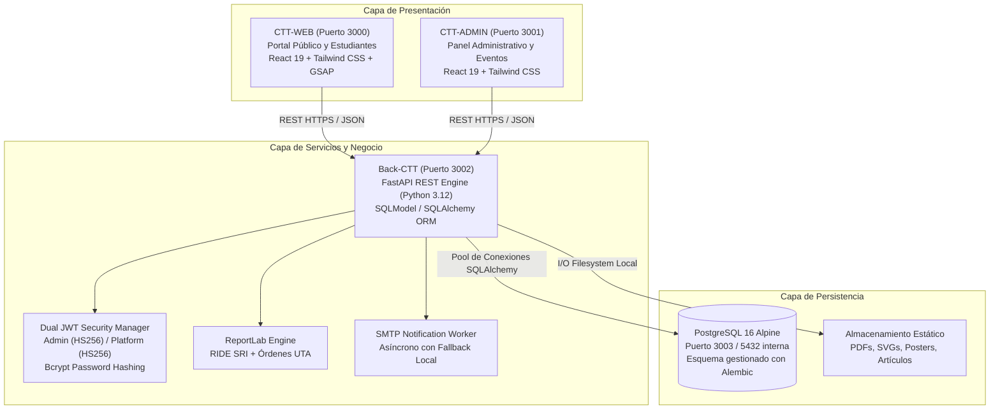

# Arquitectura del Sistema CTT-FISEI

La plataforma tecnológica del Centro de Transferencia y Desarrollo de Tecnologías (CTT) de la Facultad de Ingeniería en Sistemas, Electrónica e Industrial (FISEI) de la Universidad Técnica de Ambato (UTA) está concebida como un ecosistema empresarial desacoplado, escalable y orientado a servicios. Su propósito central es la gestión integral de programas de capacitación continua, congresos científicos de alto impacto (tales como CSEI y CISED), control de aforo en tiempo real, validación biométrica/QR de asistencia a sesiones magistrales, conciliación de pagos con tarifas diferenciadas y generación automatizada de comprobantes tributarios electrónicos RIDE bajo normativa del SRI ecuatoriano.

## Visión Global del Sistema

El ecosistema CTT-FISEI resuelve la interoperabilidad entre la oferta académica universitaria y la comunidad (estudiantes de grado, profesionales externos, ponentes internacionales y personal administrativo). Opera bajo un modelo multi-tier distribuido que separa taxativamente la capa de presentación (frontends especializados), la capa de servicios de dominio (API REST FastAPI) y la capa de persistencia relacional transaccional (PostgreSQL 16 con extensiones de integridad).

## Ecosistema Multi-Tier Integrado

La arquitectura está particionada en tres capas funcionales complementarias:

1. **Capa Cliente / Frontends Especializados**:
   - **CTT-WEB**: Diseñado bajo una filosofía móvil primero (mobile-first), enfocado en la experiencia del participante. Facilita la exploración del catálogo unificado de cursos y congresos, inscripción con verificación inmediata de cupos, pasarela de órdenes de pago, descarga de pases digitales QR, postulación de ponencias científicas (Call for Papers) y evaluación de satisfacción con la encuesta de calidad institucional CACES.
   - **CTT-ADMIN**: Diseñado para la gestión operativa, financiera y académica. Proporciona control de cronogramas y ponentes, escáner de códigos QR en vivo para control de asistencia a sesiones con detección de colisiones HTTP 409, auditoría y aprobación de comprobantes bancarios, métricas financieras en tiempo real y exportación de matrículas hacia entornos virtuales de aprendizaje Moodle LMS.

2. **Capa de Lógica de Negocio y API Gateway (Back-CTT)**:
   - Construido con **FastAPI** sobre Python 3.12. Proporciona serialización y validación estricta de esquemas mediante Pydantic, transaccionalidad atómica a través de SQLModel, inyección de dependencias modular para aislamiento de sesiones de base de datos (`SessionDep`), middlewares de seguridad CORS y control unificado de excepciones de base de datos.

3. **Capa de Persistencia y Almacenamiento**:
   - **PostgreSQL 16**: Motor relacional robusto que asegura integridad referencial, bloqueos transaccionales para evitar sobrecupos y aislamiento ACID.
   - **Alembic**: Sistema de control de versiones y migraciones de esquema de base de datos automatizado, ejecutado previamente al inicio del servidor HTTP.
   - **Almacenamiento Estático Local**: Directorios organizados para la persistencia y distribución segura de comprobantes RIDE, órdenes de pago en PDF, artículos científicos en formato digital y banners de eventos.

## Principios de Diseño Arquitectónico

- **Desacoplamiento Estricto**: Los frontends consumen exclusivamente la API REST mediante contratos JSON y tokens de portador (Bearer JWT), eliminando cualquier acoplamiento de renderizado del lado del servidor.
- **Seguridad en Profundidad**: Autenticación dual segregada. Los usuarios administradores y los participantes de plataforma operan con modelos, tablas y flujos de emisión de tokens totalmente diferenciados. Las contraseñas se almacenan mediante el algoritmo `bcrypt` con truncamiento seguro a 72 bytes.
- **Tolerancia a Fallos y Modo Fallback**: El motor de correos SMTP transaccionales opera de manera asíncrona mediante hilos demonio y cuenta con un mecanismo de fallback que registra el despacho en logs cuando el servidor de correo no está disponible, evitando caídas en las transacciones críticas del usuario.
- **Diseño Limpio y Reglas Institucionales**: Apego absoluto a la identidad institucional de la Universidad Técnica de Ambato, utilizando el color corporativo azul `#00345e`, tipografía legible y exclusión de elementos superfluos en encabezados.

## Índice de Documentos de Arquitectura

Para profundizar en el diseño e integración del ecosistema, consulte:

- [Arquitectura Integrada del Ecosistema](arquitectura-integrada.md): Diagramas de capas, diagramas de secuencia de los flujos críticos (inscripción, escaneo QR y autenticación dual) y matriz de comunicación entre servicios.
- [Volver al Portal Principal de Documentación](../README.md)
