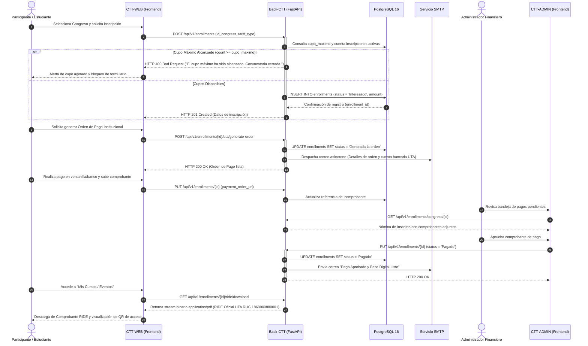
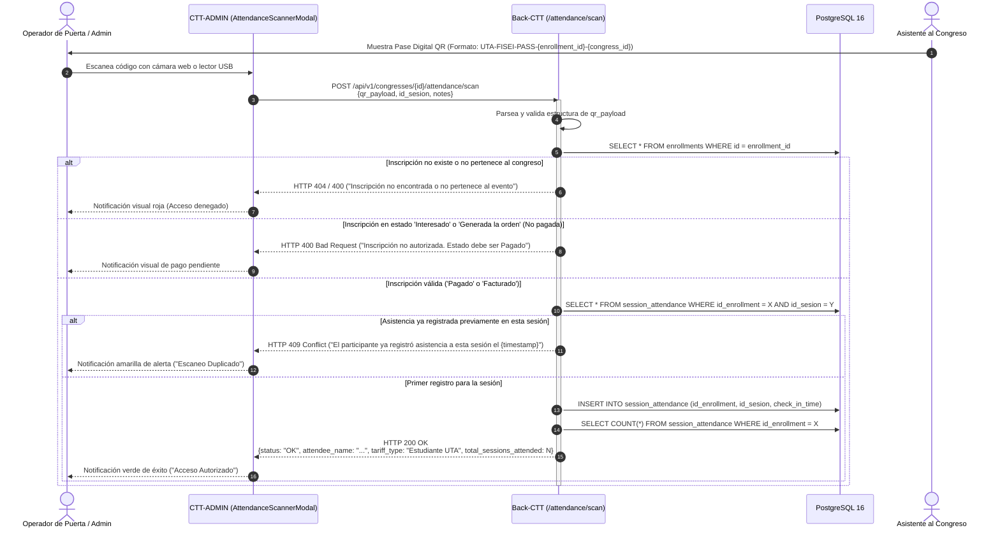
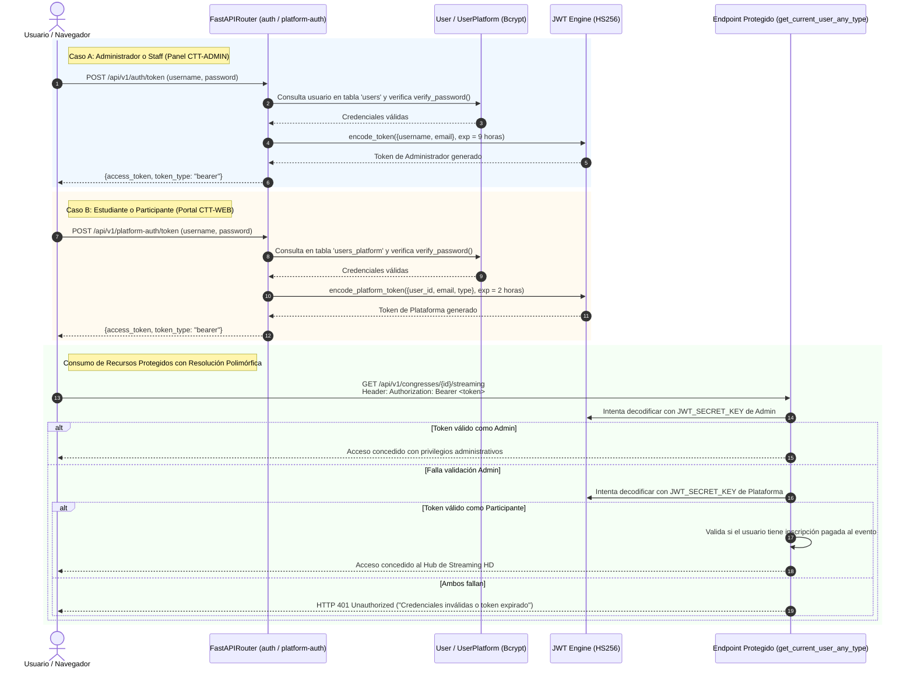

# Arquitectura Integrada del Ecosistema CTT-FISEI

Este documento describe la estructura técnica y de comunicación que articula las aplicaciones del ecosistema CTT-FISEI: el backend REST (`Back-CTT`), el portal público y de estudiantes (`CTT-WEB`), y el panel de administración institucional (`CTT-ADMIN`).

## Arquitectura General en Capas

El ecosistema opera mediante una arquitectura multicapa en la que cada nivel asume responsabilidades delimitadas para garantizar alta cohesión, bajo acoplamiento e independencia de despliegue.

```mermaid
graph TB
    subgraph Cliente["Nivel de Cliente y Presentación"]
        direction LR
        WEB["CTT-WEB<br/>Single Page Application (React 19)<br/>Puerto Host: 3000<br/>Vite + Tailwind CSS + GSAP"]
        ADMIN["CTT-ADMIN<br/>Single Page Application (React 19)<br/>Puerto Host: 3001<br/>Vite + Tailwind CSS + Lucide Icons"]
    end

    subgraph GatewayLogica["Nivel de API y Lógica de Negocio (Back-CTT)"]
        direction TB
        MW["Middlewares de Servidor<br/>- CORS (ALLOWED_ORIGINS)<br/>- Error Handler (Database & Internal Error Normalization)<br/>- Static Files Handler (/static)"]
        
        subgraph Routers["Controladores REST (FastAPI Routers)"]
            R_AUTH["Auth Routers<br/>/api/v1/auth<br/>/api/v1/platform-auth"]
            R_USERS["Users Router<br/>/api/v1/users"]
            R_ENROLL["Enrollments Router<br/>/api/v1/enrollments"]
            R_CONG["Congress Router<br/>/api/v1/congresses<br/>/api/v1/congresses-new"]
            R_COURSES["Courses Router<br/>/api/v1/courses"]
            R_SESS["Sessions Router<br/>/api/v1/sessions"]
        end

        subgraph Dominio["Capa de Servicios y Controladores de Dominio"]
            C_ENROLL["EnrollmentController<br/>Validación de Cupo Máximo y Estados"]
            C_CONG["CongressController<br/>Gestión de Eventos, Sedes y Ediciones"]
            C_USER["UserController & UserPlatformController<br/>Gestión de Perfiles y Credenciales"]
            C_ATT["Attendance Engine<br/>Validación de Códigos QR y Control 409"]
            C_MOODLE["Moodle LMS Exporter<br/>Generación CSV y REST API Sync"]
            C_PDF["PDF Engines<br/>RIDE Generator SRI & UTA Order Generator"]
            C_NOTIF["Email Notification Engine<br/>Notificaciones Transaccionales SMTP"]
        end
    end

    subgraph Persistencia["Nivel de Persistencia y Almacenamiento"]
        direction LR
        DB[(PostgreSQL 16 Engine<br/>Base de Datos: ctt_db<br/>Esquema Normalizado + Alembic)]
        STORAGE["Sistema de Archivos Local<br/>static/pdf/ (Comprobantes RIDE)<br/>static/images/ (Fotos y Posters)<br/>static/svg/ (Íconos de Categorías)"]
    end

    WEB -->|HTTP POST/GET/PUT (JSON)| MW
    ADMIN -->|HTTP POST/GET/PUT/PATCH/DELETE (JSON)| MW
    MW --> Routers
    R_AUTH --> C_USER
    R_USERS --> C_USER
    R_ENROLL --> C_ENROLL
    R_ENROLL --> C_PDF
    R_ENROLL --> C_NOTIF
    R_CONG --> C_CONG
    R_CONG --> C_ATT
    R_CONG --> C_MOODLE
    R_CONG --> C_PDF
    
    C_ENROLL -->|SQLModel / SQLAlchemy| DB
    C_CONG -->|SQLModel / SQLAlchemy| DB
    C_USER -->|SQLModel / SQLAlchemy| DB
    C_ATT -->|SQLModel / SQLAlchemy| DB
    C_PDF -->|I/O Binario| STORAGE
    C_PDF -->|Descarga Directa StreamingResponse| WEB
```

---

## Flujos de Secuencia de Procesos Clave

A continuación se detallan los tres flujos neurálgicos del ecosistema mediante diagramas de secuencia Mermaid.

### 1. Flujo de Inscripción, Generación de Orden y Pago

Este flujo describe la interacción cuando un participante se inscribe en un evento académico, la verificación atómica de cupos disponibles (`cupo_maximo`), la emisión de la orden de pago institucional UTA y la posterior validación financiera que activa el pase digital y el comprobante RIDE oficial.



---

### 2. Flujo de Escaneo y Validación de Asistencia QR en Sesiones

Este proceso ocurre durante la ejecución de los congresos en los auditorios de la FISEI. La aplicación administrativa escanea la credencial digital del asistente y el backend aplica validaciones estrictas de acreditación y control de concurrencia para evitar doble registro.



---

### 3. Flujo de Autenticación Dual JWT

El ecosistema no mezcla las identidades de la administración universitaria con las de los participantes externos o estudiantes. Se implementa un esquema dual con dos cadenas de emisión y validación complementarias.



---

## Matriz de Comunicación Entre Aplicaciones

La siguiente matriz describe detalladamente la topología de red, protocolos, orígenes, destinos y esquemas de payload involucrados en la integración del sistema CTT-FISEI:

| Componente Origen | Componente Destino | Puerto Destino | Protocolo | Endpoint / Canal | Propósito y Contrato de Payload |
|---|---|---|---|---|---|
| `CTT-WEB` | `Back-CTT` | `3002` (Host) / `8000` (Docker) | HTTP/1.1 (JSON) | `POST /api/v1/platform-auth/token` | Inicio de sesión de participantes. Body: `OAuth2PasswordRequestForm` (`username`, `password`). Retorna `access_token` JWT. |
| `CTT-WEB` | `Back-CTT` | `3002` (Host) / `8000` (Docker) | HTTP/1.1 (JSON) | `POST /api/v1/enrollments` | Creación de inscripción. Payload: `{id_user_platform, id_congress, tariff_type, amount}`. Validación de `cupo_maximo`. |
| `CTT-WEB` | `Back-CTT` | `3002` (Host) / `8000` (Docker) | HTTP/1.1 (Binario) | `GET /api/v1/enrollments/{id}/ride/download` | Descarga de factura electrónica / RIDE oficial en PDF con RUC institucional `1860000880001`. |
| `CTT-WEB` | `Back-CTT` | `3002` (Host) / `8000` (Docker) | HTTP/1.1 (JSON) | `POST /api/v1/congresses/{id}/papers` | Postulación Call for Papers. Payload: `{title, abstract, track, keywords, file_url}`. |
| `CTT-WEB` | `Back-CTT` | `3002` (Host) / `8000` (Docker) | HTTP/1.1 (JSON) | `POST /api/v1/congresses/{id}/survey` | Registro de encuesta CACES. Payload: `{q1_rating, q2_rating, q3_rating, comments}` con valores de 1 a 5 estrellas. |
| `CTT-ADMIN` | `Back-CTT` | `3002` (Host) / `8000` (Docker) | HTTP/1.1 (JSON) | `POST /api/v1/auth/token` | Inicio de sesión administrativo. Body: `username`, `password`. Retorna `access_token` con claims de administración. |
| `CTT-ADMIN` | `Back-CTT` | `3002` (Host) / `8000` (Docker) | HTTP/1.1 (JSON) | `POST /api/v1/congresses/{id}/attendance/scan` | Escaneo de credenciales en puerta. Payload: `{qr_payload, id_sesion, notes}`. Detección de duplicados con HTTP 409. |
| `CTT-ADMIN` | `Back-CTT` | `3002` (Host) / `8000` (Docker) | HTTP/1.1 (CSV) | `GET /api/v1/congresses/{id}/export/moodle-csv` | Exportación por lotes para Moodle LMS. Retorna archivo plano con cabeceras `username,firstname,lastname,email,course1,role1`. |
| `CTT-ADMIN` | `Back-CTT` | `3002` (Host) / `8000` (Docker) | HTTP/1.1 (JSON) | `PUT /api/v1/congresses/{id}/papers/{id}/review` | Calificación de ponencia científica. Payload: `{status: "APROBADO", reviewer_comments}`. Actualiza tarifa a $80.00. |
| `Back-CTT` | `PostgreSQL` | `3003` (Host) / `5432` (Docker) | TCP (PostgreSQL Wire Protocol) | Conexión `psycopg2` | Ejecución transaccional de consultas SQL, control de llaves foráneas y persistencia relacional. |
| `Back-CTT` | Servidor SMTP UTA | `587` (TLS) / `465` (SSL) | SMTP / MIME | `smtp.uta.edu.ec` o similar | Notificaciones transaccionales automáticas con plantillas HTML responsive y fallback de consola en desarrollo. |

---

## Estrategia de Manejo de Errores y Resiliencia

1. **Aislamiento de Excepciones de Base de Datos**: A través del middleware `error_handler_middleware`, cualquier error originado en PostgreSQL (`OperationalError`, `IntegrityError`, `DatabaseError`) es interceptado y sanitizado, retornando una respuesta estándar HTTP 500 sin exponer credenciales internas ni volcados de pila (stack traces).
2. **Rotación Automática de Registros (Logs)**: El sistema implementa `RotatingFileHandler` delimitado a 10 MB por archivo y hasta 5 respaldos históricos tanto para eventos de información (`logs/app.log`) como para anomalías críticas (`logs/error.log`).
3. **Control Concurrente de Aforo**: Las validaciones de cupo en inscripciones y de asistencia en sesiones operan dentro de transacciones de base de datos atómicas, garantizando coherencia incluso bajo concurrencia elevada.
