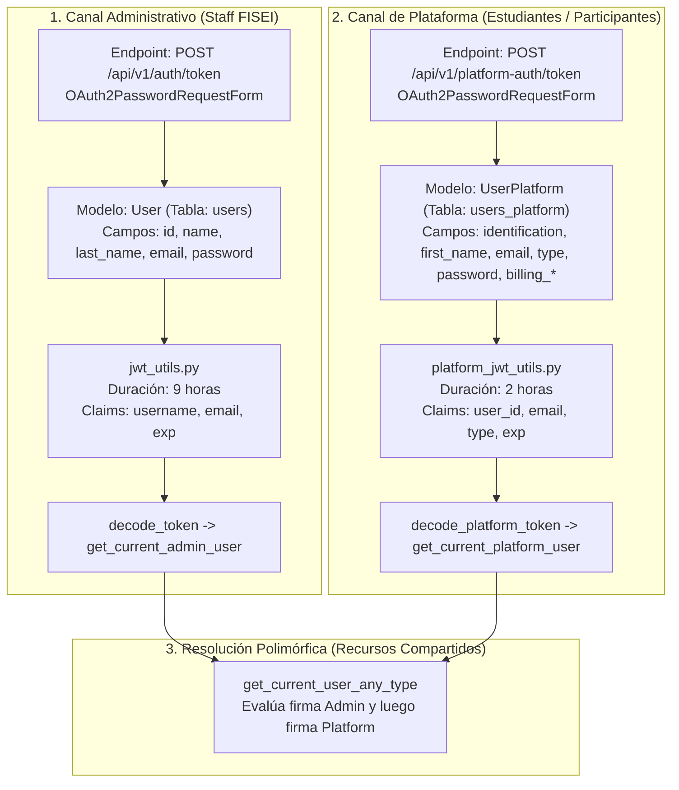

# Sistema de Autenticación Dual JWT y Seguridad

El backend del sistema CTT-FISEI implementa un esquema de **autenticación dual segregada**. Esta arquitectura responde a la necesidad institucional de separar de manera estricta los privilegios y las identidades del personal universitario administrativo frente a los miles de estudiantes, profesionales y ponentes que acceden a la oferta de cursos y congresos.

## Arquitectura de Autenticación Dual

El sistema define dos canales independientes de autenticación y emisión de credenciales:



---

## Estructura de Tokens y Claims

Ambos canales emplean el estándar **JSON Web Token (RFC 7519)** con el algoritmo de firma simétrica **HMAC con SHA-256 (`HS256`)**. La clave criptográfica se suministra a través de la variable de entorno `JWT_SECRET_KEY`.

### 1. Token de Administrador (`jwt_utils.py`)

- **Expiración**: 9 horas a partir de su emisión (`timedelta(hours=9)`), adaptado a la jornada laboral extendida de los administradores y organizadores de eventos en campus.
- **Estructura del Payload (Claims)**:
  ```json
  {
    "username": "admin_fisei",
    "email": "coordinador.ctt@uta.edu.ec",
    "exp": 1794123600
  }
  ```

### 2. Token de Plataforma (`platform_jwt_utils.py`)

- **Expiración**: 2 horas a partir de su emisión (`timedelta(hours=2)`), minimizando la ventana de exposición para sesiones de participantes que ingresan desde dispositivos móviles o redes públicas.
- **Estructura del Payload (Claims)**:
  ```json
  {
    "user_id": 42,
    "email": "carlos.mora@uta.edu.ec",
    "type": "Estudiante",
    "exp": 1794098400
  }
  ```
- **Roles / Tipos Admitidos**:
  - `Estudiante`: Estudiantes regulares de pregrado o posgrado de la Universidad Técnica de Ambato.
  - `Externo`: Profesionales, investigadores y público general.
  - `Administrativo`: Personal de soporte de facultades.

---

## Hashing Seguro de Contraseñas con Bcrypt

Tanto el modelo `User` como el modelo `UserPlatform` implementan métodos estáticos y de instancia dedicados para el cifrado y validación de contraseñas utilizando la biblioteca `bcrypt`:

```python
import bcrypt

class UserPlatform(UserPlatformBase, table=True):
    # ...
    def verify_password(self, plain_password: str) -> bool:
        """Verifica una contraseña en texto plano contra el hash almacenado."""
        password_bytes = plain_password[:72].encode('utf-8')
        hashed_bytes = self.password.encode('utf-8')
        return bcrypt.checkpw(password_bytes, hashed_bytes)

    @staticmethod
    def hash_password(password: str) -> str:
        """Genera un hash con sal aleatoria (salt) para almacenamiento persistente."""
        password_bytes = password[:72].encode('utf-8')
        salt = bcrypt.gensalt()
        hashed = bcrypt.hashpw(password_bytes, salt)
        return hashed.decode('utf-8')
```

### Reglas Críticas de Seguridad Aplicadas

1. **Truncamiento Defensivo a 72 Bytes**: Bcrypt tiene una limitación algorítmica documentada de 72 bytes de entrada. Para evitar excepciones no controladas o vulnerabilidades de denegación de servicio si un atacante envía cadenas arbitrariamente largas, las contraseñas se truncan explícitamente a 72 caracteres UTF-8 (`plain_password[:72].encode('utf-8')`).
2. **Generación de Sal Criptográfica (Salt)**: Mediante `bcrypt.gensalt()`, cada hash generado incluye una sal aleatoria única, previniendo ataques basados en tablas arcoíris (rainbow tables).
3. **Inmutabilidad de Identificación en Actualizaciones**: En los endpoints de actualización de perfil (`PUT /api/v1/users/{id}/profile`), el campo `identification` (cédula o RUC) es estrictamente inmutable; el backend ignora cualquier intento de modificación de la cédula para preservar la integridad de los registros académicos y de facturación.

---

## Dependencias de Seguridad para Protección de Rutas

FastAPI gestiona la protección de endpoints a través de dependencias inyectables:

### 1. Protección Exclusiva para Administradores

Utilizado en creación y edición de congresos, dictamen de ponencias y consultas estadísticas globales:

```python
async def get_current_admin_user(token: str = Depends(decode_token)) -> User:
    # Decodifica el token con JWT_SECRET_KEY, consulta User por email en BD
    # y eleva HTTP 401 si el token expiró o el usuario no existe.
    return token
```

### 2. Protección Exclusiva para Participantes

Utilizado en visualización de pase digital QR propio, perfil personal y postulación de artículos científicos:

```python
async def get_current_platform_user(token: str = Depends(decode_platform_token)) -> UserPlatform:
    # Decodifica con el esquema de OAuth2 de plataforma (/api/v1/platform-auth/token)
    # y valida la existencia del participante en la tabla users_platform.
    return token
```

### 3. Resolución Polimórfica (`get_current_user_any_type`)

Existen recursos compartidos donde tanto un administrador como un estudiante tienen derecho de acceso (por ejemplo, ver detalles de una inscripción o acceder a la sala de streaming del congreso si se cuenta con ticket pagado).

```python
async def get_current_user_any_type(
    db: SessionDep,
    credentials: HTTPAuthorizationCredentials = Depends(security_bearer),
) -> tuple[Union[User, UserPlatform], str]:
    token = credentials.credentials

    # Paso 1: Intentar decodificar como Administrador
    try:
        data = jwt.decode(token, JWT_SECRET_KEY, algorithms=["HS256"])
        email = data.get("email")
        if email:
            user = UserController.get_user_by_email(email, db)
            if user:
                return user, "admin"
    except Exception:
        pass

    # Paso 2: Intentar decodificar como Participante de Plataforma
    try:
        data = jwt.decode(token, JWT_SECRET_KEY, algorithms=["HS256"])
        email = data.get("email")
        if email:
            user = UserPlatformController.get_user_by_email(email, db)
            if user:
                return user, "platform"
    except Exception:
        pass

    # Si ninguna de las dos identidades es válida
    raise HTTPException(
        status_code=status.HTTP_401_UNAUTHORIZED,
        detail="Credenciales inválidas o token expirado",
    )
```

Esta función retorna una tupla `(usuario, tipo)`, permitiendo a los controladores verificar condiciones adicionales como:

```python
current_user, user_type = user_data
if user_type == "platform":
    # Validar que el participante sea el dueño de la inscripción o cuente con pago aprobado
    ...
```
