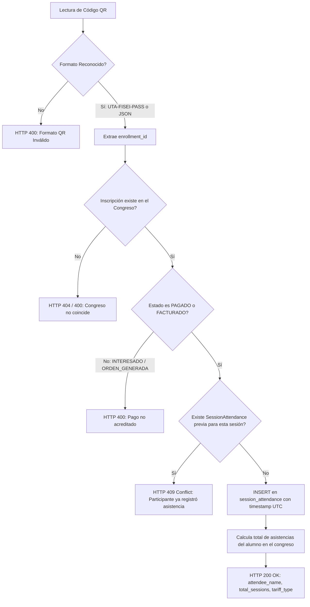

# Controladores y Lógica de Negocio en Back-CTT

Este documento describe la capa de controladores y servicios de dominio en `Back-CTT`, detallando las reglas de negocio críticas implementadas para el funcionamiento operativo, académico y financiero de los cursos y congresos universitarios.

## 1. Control de Cupo Máximo en Inscripciones

El control de aforo previene la sobreventa de cupos en auditorios y laboratorios de la FISEI. La lógica se implementa a nivel de controlador en `src/controllers/enrollment_controller.py`:

```python
# Validar cupo máximo en congresos
if not is_course_enrollment:
    if getattr(resource, "cupo_maximo", None) and resource.cupo_maximo > 0:
        active_statuses = [
            EnrollmentStatus.PAGADO,
            EnrollmentStatus.FACTURADO,
            EnrollmentStatus.INTERESADO,
            EnrollmentStatus.ORDEN_GENERADA,
        ]
        active_count = db.exec(
            select(func.count(Enrollment.id)).where(
                Enrollment.id_congress == enrollment_data.id_congress,
                Enrollment.status.in_(active_statuses),
            )
        ).one()
        if active_count >= resource.cupo_maximo:
            raise ValueError(
                f"El cupo máximo ({resource.cupo_maximo} participantes) ha sido alcanzado. Convocatoria cerrada."
            )
```

### Reglas de Negocio del Aforo

1. **Estados que Ocupan Cupo**: Se consideran participantes activos aquellos con estados `INTERESADO`, `ORDEN_GENERADA`, `PAGADO` o `FACTURADO`. Mientras una orden esté en proceso o pendiente de pago, reserva temporalmente una plaza.
2. **Liberación de Plazas por Anulación**: Si una inscripción cambia a estado `ANULADO`, la consulta SQL excluye dicho registro del conteo activo (`EnrollmentStatus.ANULADO`), liberando automáticamente el cupo para otro postulante.
3. **Mapeo a Código HTTP 400**: Cuando el controlador lanza `ValueError`, el router correspondiente captura la excepción y retorna un código `HTTP 400 Bad Request` con el mensaje:
   ```json
   {
     "detail": "El cupo máximo (N participantes) ha sido alcanzado. Convocatoria cerrada."
   }
   ```

---

## 2. Escaneo y Validación de Asistencia QR a Sesiones

El módulo de acreditación de asistencia opera en el endpoint `POST /api/v1/congresses/{id_congreso}/attendance/scan` dentro de `src/routes/congress_router.py`.

### Algoritmo de Procesamiento del Código QR



### Control de Conflictos (HTTP 409)

Para garantizar la integridad del registro y evitar fraudes o duplicidad por múltiples lecturas rápidas del sensor óptico, se ejecuta una consulta previa en la tabla `session_attendance`:

```python
existing = db.exec(
    select(SessionAttendance).where(
        SessionAttendance.id_enrollment == enrollment.id,
        SessionAttendance.id_sesion == payload.id_sesion
    )
).first()
if existing:
    raise HTTPException(
        status_code=status.HTTP_409_CONFLICT,
        detail=f"El participante ya registró asistencia a esta sesión el {existing.check_in_time.isoformat()}"
    )
```

En caso de éxito, retorna:
```json
{
  "status": "OK",
  "attendee_name": "Carlos Mora Sanchez",
  "tariff_type": "Estudiante UTA",
  "total_sessions_attended": 3
}
```

---

## 3. Exportador Moodle LMS y Sincronización REST

Para la matriculación automática de los participantes en las aulas virtuales institucionales de la UTA, `Back-CTT` ofrece dos mecanismos complementarios:

### A. Exportación por Lotes en CSV (`GET /api/v1/congresses/{id}/export/moodle-csv`)

Genera dinámicamente un archivo CSV en memoria cumpliendo con las especificaciones del módulo oficial de importación de usuarios de Moodle:

```python
writer = csv.writer(csv_buffer, lineterminator="\n")
writer.writerow(["username", "firstname", "lastname", "email", "course1", "role1"])

for enr, usr in paid_records:
    username = usr.identification  # La cédula se usa como nombre de usuario institucional
    firstname = usr.first_name
    lastname = f"{usr.first_last_name} {usr.second_last_name or ''}".strip()
    email = usr.email
    course_code = (congress.edicion or f"CONG-{id_congreso}").strip().replace(" ", "_")
    
    # Asignación de rol pedagógico según la tarifa cancelada
    tariff_raw = (getattr(enr, "tariff_type", None) or "").lower()
    role = "editingteacher" if "ponente" in tariff_raw else "student"
    
    writer.writerow([username, firstname, lastname, email, course_code, role])
```

El endpoint responde con `media_type="text/csv"` y la cabecera `Content-Disposition: attachment; filename=moodle_enrollments_congreso_{id}.csv`.

### B. Sincronización REST Directa (`sync_moodle_users`)

Si las variables de entorno `MOODLE_URL` y `MOODLE_TOKEN` se encuentran configuradas en el servidor, el sistema invoca la función del Core de Moodle:
- **Función Web Service**: `core_enrol_manual_enrol_users`.
- **Payload de Sincronización**: Arreglo de inscripciones que mapea `roleid` (estudiante o profesor con permiso de edición), `userid` y `courseid`.
- **Fallback**: Si las credenciales de Moodle no están configuradas, el servicio omite la sincronización sin lanzar errores fatales (`"status": "SKIPPED"`).

---

## 4. Motor de Notificaciones Transaccionales SMTP

Ubicado en `src/utils/email_service.py`, este motor gestiona los 4 momentos del ciclo de vida de una inscripción mediante correos electrónicos con diseño responsive optimizado para dispositivos móviles:

| Momento del Ciclo de Vida | Función | Disparador | Contenido Notificado |
|---|---|---|---|
| **1. Orden Generada** | `send_order_created_notification` | Generación de Orden UTA | Resumen del valor a pagar, detalles de la cuenta corriente de la UTA en Banco del Pacífico e instrucciones de depósito. |
| **2. Pago Aprobado** | `send_payment_approved_notification` | Aprobación de comprobante por Admin | Confirmación de cupo asegurado, habilitación del Pase Digital QR e instrucciones de descarga del RIDE PDF. |
| **3. Comprobante Observado** | `send_receipt_rejected_notification` | Rechazo de comprobante por Admin | Detalle del motivo de inconsistencia o ilegibilidad y enlace directo para resubir un nuevo archivo. |
| **4. Recordatorio 24 Horas** | `send_reminder_24h_notification` | Tarea programada previa al evento | Sede física (Auditorio Central FISEI), requisitos de ingreso en puerta y cronograma de apertura de puertas. |

### Arquitectura Asíncrona y Modo Fallback

1. **Despacho No Bloqueante**: La función `send_email_async` instancia un hilo demonio (`threading.Thread(target=..., daemon=True)`), asegurando que los tiempos de respuesta HTTP del API permanezcan por debajo de 50 milisegundos, con total independencia del tiempo de conexión al servidor SMTP.
2. **Modo Fallback en Desarrollo**: Si la variable de entorno `SMTP_HOST` no está configurada (por ejemplo, en entornos de desarrollo local o durante pruebas unitarias), el servicio simula el envío exitoso registrando el destinatario y el asunto en los logs con el prefijo `[EMAIL DEV FALLBACK]`.

---

## 5. Módulo Call for Papers (CFP) y Calificación de Ponencias

Diseñado para la gestión editorial de eventos científicos (CSEI / CISED):

1. **Postulación (`POST /api/v1/congresses/{id}/papers`)**: Permite a investigadores enviar títulos, resúmenes, áreas temáticas (*tracks*), palabras clave y la URL al manuscrito en formato PDF. El estado inicial asignado es `ENVIADO`.
2. **Revisión y Dictamen (`PUT /api/v1/congresses/{id}/papers/{paper_id}/review`)**: Exclusivo para administradores y miembros del comité editorial. Permite cambiar el estado a `APROBADO`, `RECHAZADO` o `CORRECCIONES_REQUERIDAS` con comentarios de los evaluadores.
3. **Efecto de Negocio Automático tras Aprobación**: Si el dictamen es `APROBADO`, el controlador busca la inscripción del autor o crea una nueva, actualizando automáticamente su tarifa a **`PONENTE`** y fijando el monto oficial en **$80.00 USD**.

---

## 6. Encuesta de Calidad Académica CACES

Para dar cumplimiento a los estándares de acreditación del Consejo de Aseguramiento de la Calidad de la Educación Superior (CACES), el sistema incorpora un módulo de evaluación en `POST /api/v1/congresses/{id}/survey`:

- **Escala de Likert (1 a 5 Estrellas)**: Valida rigurosamente que las calificaciones `q1_rating`, `q2_rating` y `q3_rating` cumplan con la restricción `1 <= q <= 5`.
- **Preguntas Evaluadas**:
  - `q1_rating`: Calidad y pertinencia de los contenidos temáticos impartidos.
  - `q2_rating`: Dominio y claridad pedagógica de los conferencistas magistrales.
  - `q3_rating`: Organización logística, puntualidad e infraestructura del evento.
- **Estadísticas Consolidadas (`GET /api/v1/congresses/{id}/survey/stats`)**: Retorna el promedio por cada dimensión evaluada (`avg_q1`, `avg_q2`, `avg_q3`), el promedio global y la recopilación cualitativa de comentarios para informes de acreditación universitaria.
