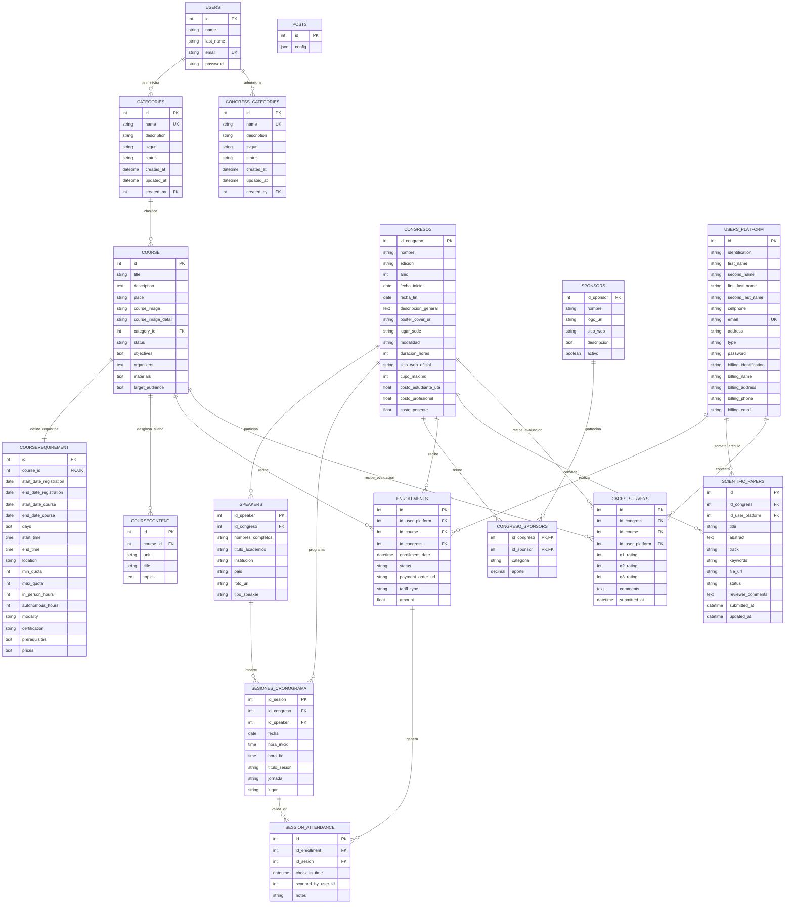
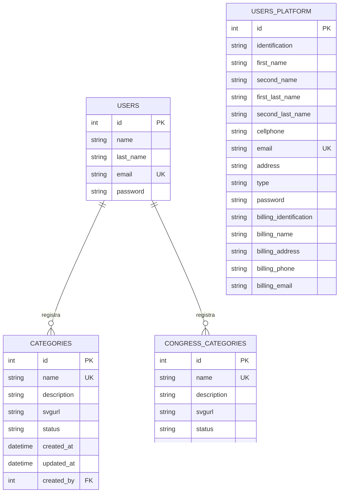
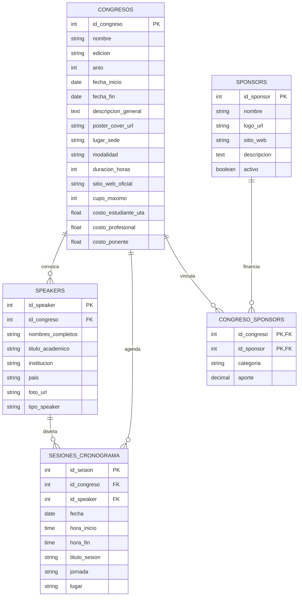
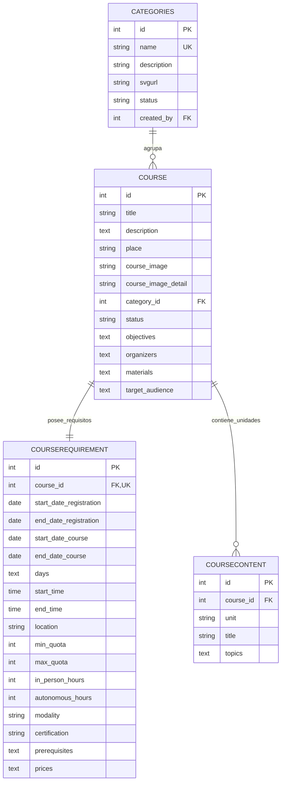
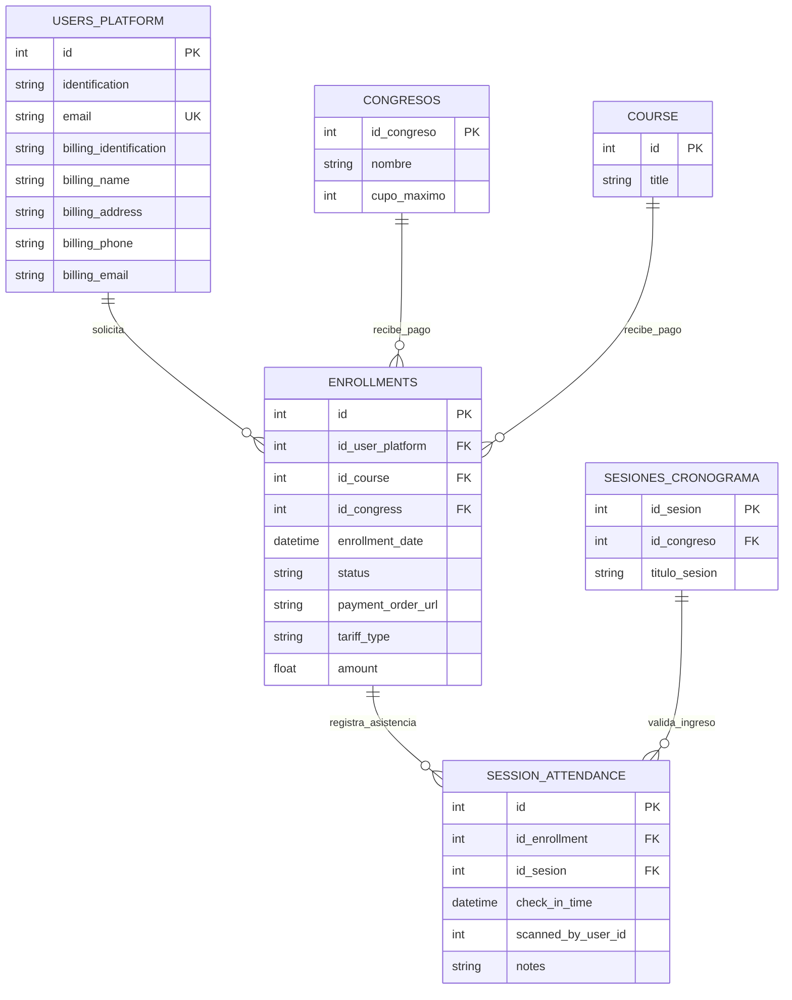
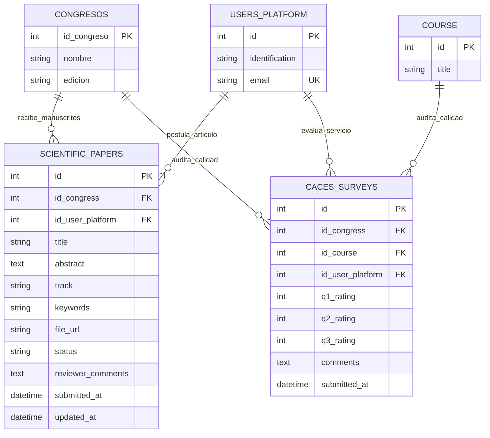

# Diagramas Entidad-Relación - Base de Datos CTT FISEI

Este documento contiene los diagramas Entidad-Relación (ER) del modelo de datos de la plataforma CTT FISEI, renderizados mediante sintaxis estricta de **Mermaid**. Se presentan tanto el diagrama macro de todo el ecosistema como los diagramas modulares de cada área de negocio.

---

## 1. Diagrama Macro del Ecosistema Relacional

El siguiente diagrama modela las 17 tablas relacionales y sus vínculos cardinales en el sistema de gestión del CTT FISEI:

---

## 2. Módulo de Autenticación y Cuentas de Usuario

Representa la separación estricta entre el personal administrativo de FISEI (`users`) y los usuarios finales de la plataforma académica (`users_platform`), además de la trazabilidad en la creación de categorías institucionales:

---

## 3. Módulo de Congresos, Cronogramas y Auspiciantes

Detalla la arquitectura de gestión de eventos internacionales como CSEI y CISED, coordinando conferencistas magistrales, agenda horaria y alianzas con patrocinadores:

---

## 4. Módulo de Cursos de Formación Continua

Modela la oferta de capacitación técnica del CTT, su dependencia de categorías temáticas y su descomposición en requerimientos operativos (1:1) y unidades de contenido modular (1:N):

---

## 5. Módulo de Inscripciones, Asistencia QR y Facturación RIDE

Ilustra la relación polimórfica exclusiva (XOR) en `enrollments`, el control de asistencia presencial por escaneo QR y los datos de facturación electrónica:

---

## 6. Módulo de Investigación (Call for Papers) y Calidad CACES

Modela el flujo de postulación y revisión de artículos científicos para congresos indexados (Scopus/IEEE), junto con las encuestas de satisfacción académica requeridas para acreditación universitaria:

