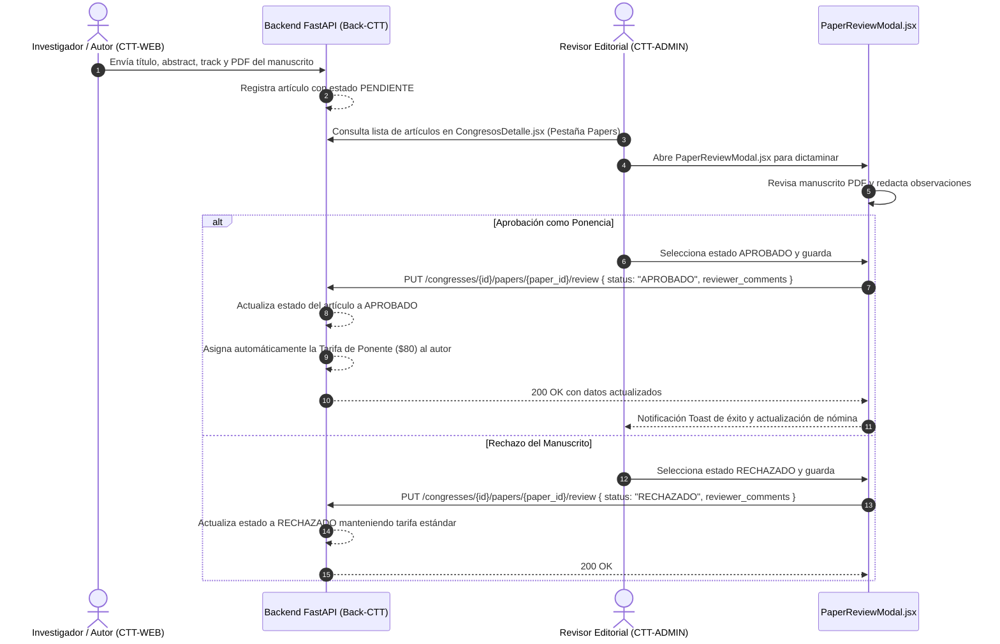

# Módulo de Call for Papers y Arbitraje Científico (CTT-ADMIN)

Este documento detalla la arquitectura del módulo de gestión, revisión por pares y acreditación de ponencias científicas (**Call for Papers - CFP**) dentro del panel de administración **CTT-ADMIN**.

---

## 1. Visión General del Proceso Editorial

Los congresos internacionales organizados por la FISEI (como CSEI y CISED) cuentan con una convocatoria abierta para la recepción de manuscritos científicos. Los autores postulan sus trabajos desde el portal web `CTT-WEB`, y el comité editorial o tribunal académico evalúa y dictamina las postulaciones desde `CTT-ADMIN`:



---

## 2. Pestaña de Artículos Científicos (`CongresosDetalle.jsx`)

Dentro de la ficha del congreso, la pestaña `"papers"` despliega el listado completo de postulaciones científicas recibidas para el evento:

- **Metadatos del Manuscrito**:
  - Título del artículo científico.
  - Nombre y correo electrónico del autor de correspondencia.
  - Track temático (Inteligencia Artificial, Sistemas Embebidos, Ciberseguridad, Redes o Automatización).
  - Palabras clave (*keywords*).
  - Estado del arbitraje: `PENDIENTE`, `APROBADO` o `RECHAZADO`.
- **Acceso al Documento**: Enlace seguro para abrir o descargar el archivo PDF original remitido por el autor.
- **Acción Editorial**: Botón de acceso directo para abrir el modal `PaperReviewModal.jsx`.

---

## 3. Modal de Dictamen Editorial (`PaperReviewModal.jsx`)

El componente `PaperReviewModal.jsx` implementa una interfaz ergonómica que combina el visor de información académica con el formulario de resolución editorial:

```jsx
export default function PaperReviewModal({
  isOpen,
  onClose,
  paper,
  congressId,
  onSuccess,
}) {
  const [status, setStatus] = useState("APROBADO");
  const [reviewerComments, setReviewerComments] = useState("");
  const [loading, setLoading] = useState(false);

  // ... lógica de envío hacia PUT /congresses/{id}/papers/{paper.id}/review
}
```

### 3.1 Componentes de la Interfaz
1. **Ficha del Manuscrito**: Muestra el título completo, autor, palabras clave y el resumen o *abstract* académico con scroll independiente.
2. **Acceso al PDF del Artículo**: Botón destacado que abre el documento en una nueva pestaña del navegador utilizando la utilidad `resolveImageUrl(paper.file_url)`.
3. **Selector de Dictamen**:
   - `APROBADO`: Concede al autor el derecho de presentar su investigación en las sesiones orales del congreso y acceder a la tarifa preferencial de ponente.
   - `RECHAZADO`: Desestima la ponencia para el programa oficial.
4. **Observaciones del Revisor (`reviewer_comments`)**: Campo de texto amplio para consignar correcciones formales, sugerencias del comité evaluador o justificación de la decisión editorial.

---

## 4. Asignación Automática de Tarifa Ponente ($80)

Una regla de negocio institucional clave del sistema CTT es la **acreditación arancelaria automática**:

- **Regla**: Cuando un artículo científico es dictaminado como `APROBADO`, el backend de `Back-CTT` actualiza inmediatamente la orden de matrícula del autor principal, aplicando la tarifa de **Ponente ($80.00)** en lugar de la tarifa ordinaria de profesional ($50.00).
- **Justificación**: El arancel de ponente cubre costos específicos de publicación de actas indexadas, certificado con mención de autor y credencial de expositor oficial de la UTA.
- **Transparencia en el Panel Administrativo**:
  El modal `PaperReviewModal.jsx` advierte de forma explícita al evaluador antes de enviar la resolución:
  > *"Regla de Acreditación Arancelaria: Al aprobarse, el autor recibirá automáticamente la tarifa preferencial de Ponente ($80)."*
- **Impacto Financiero**:
  La aprobación se refleja de forma inmediata en las métricas del `FinancialDashboardTab.jsx`, incrementando la recaudación proyectada en la categoría de ponentes y actualizando el presupuesto global del congreso.
