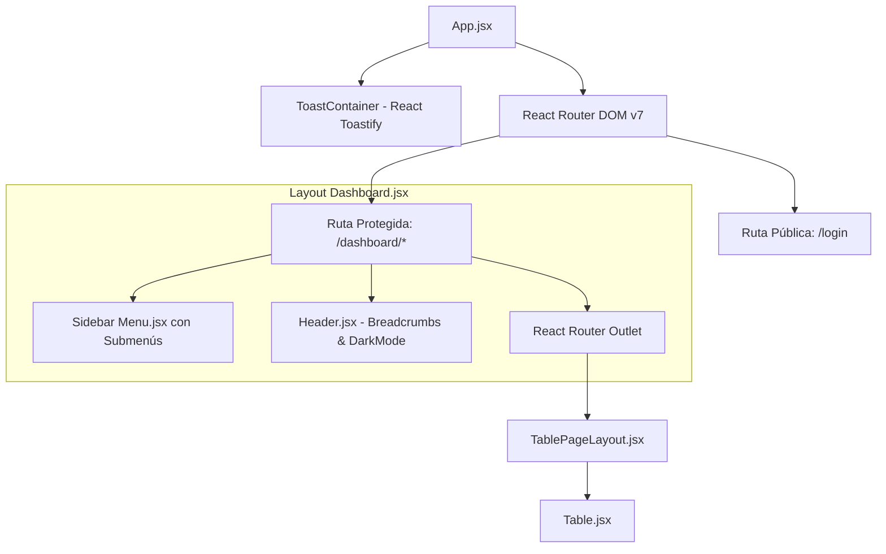

# Componentes y Sistema de Rutas (CTT-ADMIN)

Este documento detalla la arquitectura de componentes, el sistema de enrutamiento con React Router DOM v7, los mecanismos de seguridad y los componentes comunes reutilizables del panel administrativo **CTT-ADMIN**.

---

## 1. Layout Administrativo

El panel de administración utiliza un layout de cabina de control unificada compuesto por una barra lateral colapsable, una barra superior de contexto con migas de pan y un área central de trabajo dinámica:



### 1.1 Menú Lateral Colapsable (`Menu.jsx`)
El componente `Menu.jsx` administra la navegación principal del sistema a través de secciones jerárquicas:
- **Cursos**: Submenús para *Administrar Cursos* (`/dashboard/cursos/`) y *Administrar Categorías* (`/dashboard/categoriasCursos`).
- **Congresos**: Submenús para *Administrar Congresos* (`/dashboard/congresos/`) y *Categorías de Congresos* (`/dashboard/categoriasCongresos`).
- **Estudiantes**: Directorio unificado de estudiantes y participantes (`/dashboard/estudiantes/`).
- **Configuración**: Administración de banners y recursos del portal público (`/dashboard/configuracion/home`).

**Características Técnicas**:
- Permite colapsar el ancho de la barra lateral (`isCollapsed`), persistiendo el estado en `localStorage.getItem('admin_sidebar_collapsed')`.
- Apertura automática de submenús basada en la URL activa (`location.pathname`).
- Confirmación modal accesible (`ConfirmDialog.jsx`) previa al cierre de sesión (`clearAuthData`).

### 1.2 Migas de Pan Reactivas (`Breadcrumbs`)
En la cabecera del dashboard, el componente genera dinámicamente la ruta de migas de pan según la jerarquía de navegación actual (ej. `Home > Congresos > Detalle del Congreso`). Esto permite a los coordinadores ubicarse inmediatamente dentro de estructuras profundas de administración.

### 1.3 Contenedor Estándar para Tablas (`TablePageLayout.jsx`)
Para garantizar consistencia visual en todas las vistas de administración de catálogos:
```jsx
export default function TablePageLayout({ title, description, action, children }) {
  const { isDark } = useDashboardTheme();

  return (
    <div className="space-y-5">
      <div className={`flex flex-col sm:flex-row sm:items-center justify-between gap-4 p-4 sm:p-5 rounded-xl border transition-colors ${
        isDark ? 'bg-[#16161a] border-white/[0.08] shadow-sm text-white' : 'bg-white border-black/[0.08] shadow-xs text-zinc-900'
      }`}>
        <div>
          <h1 className="text-xl sm:text-2xl font-bold tracking-tight">{title}</h1>
          {description && <p className="text-xs mt-1 text-zinc-500 dark:text-zinc-400">{description}</p>}
        </div>
        {action && <div className="shrink-0">{action}</div>}
      </div>
      <div className="w-full">{children}</div>
    </div>
  );
}
```

---

## 2. Árbol de Rutas Administrativas

Las rutas están centralizadas en `src/App.jsx` bajo el guardia `PrivateRoute`:

| Ruta | Componente | Propósito Administrativo |
|---|---|---|
| `/login` | `Login.jsx` | Autenticación con usuario/correo y contraseña institucional. |
| `/dashboard` | `Navigate to="cursos"` | Redirección automática a la vista de cursos. |
| `/dashboard/cursos` | `Cursos.jsx` | Directorio de cursos de capacitación continua activos. |
| `/dashboard/cursos/:id` | `CourseDetail.jsx` | Ficha técnica de curso, costos, horas académicas y temario. |
| `/dashboard/cursos/:id/editar` | `FormCourse.jsx` | Wizard multi-paso para modificación de contenido y datos. |
| `/dashboard/cursos/:course_id/inscritos` | `Inscritos.jsx` | Nómina de estudiantes matriculados en un curso específico. |
| `/dashboard/estudiantes` | `Estudiantes.jsx` | Directorio global de participantes registrados en la plataforma. |
| `/dashboard/categoriasCursos` | `CategoriasCursos.jsx` | Mantenimiento de áreas de capacitación (Software, Redes, etc.). |
| `/dashboard/configuracion/home` | `ConfiguracionHome.jsx` | Gestión de imágenes del carrusel, avisos y enlaces de inicio. |
| `/dashboard/congresos` | `Congresos.jsx` | Catálogo de congresos científicos internacionales (CSEI, CISED). |
| `/dashboard/categoriasCongresos` | `CategoriasCongresos.jsx` | Mantenimiento de categorías y ejes temáticos de congresos. |
| `/dashboard/congresos/crear` | `FormularioCongreso.jsx` | Wizard multi-paso para la creación de un nuevo congreso. |
| `/dashboard/congresos/:id` | `CongresosDetalle.jsx` | Panel integral con pestañas: General, Cronograma, Inscritos, Finanzas, Papers. |
| `/dashboard/congresos/:id/editar` | `FormularioCongreso.jsx` | Edición de fechas, afiches, aforos y aranceles de un congreso. |

---

## 3. Seguridad y Guardias de Ruta

### 3.1 Guardia de Navegación (`PrivateRoute`)
El acceso a cualquier ruta bajo `/dashboard/*` evalúa la validez del token en `localStorage`:
```jsx
const PrivateRoute = ({ children }) => {
  return isAuthenticated() ? children : <Navigate to="/login" replace />;
};
```

### 3.2 Control de Expiración (8 Horas) y Decodificación JWT
En `src/utils/auth.js`:
- Se almacena `tokenTimestamp` junto con el token JWT.
- Si han transcurrido más de 8 horas (28.800.000 ms), se eliminan las credenciales y la función `isAuthenticated()` retorna `false`.
- La función `getUserData()` utiliza `jwtDecode` para extraer en el cliente el nombre de usuario y los roles del token, manteniendo una estructura segura por defecto `{ username: "invitado", email: "no-email@example.com" }` si el token no existe.

### 3.3 Interceptor Automático de Axios (`src/api/api.js`)
Para evitar inyectar manualmente el encabezado de autorización en cada petición, la instancia global de Axios incluye un interceptor de solicitud:
```javascript
api.interceptors.request.use(
  (config) => {
    const token = localStorage.getItem('token');
    if (token && !config.headers.Authorization) {
      config.headers.Authorization = `Bearer ${token}`;
    }
    return config;
  },
  (error) => Promise.reject(error)
);
```

---

## 4. Componentes Comunes Reutilizables

### 4.1 Tabla Dinámica (`Table.jsx`)
Ubicada en `src/components/ui/Table.jsx`, proporciona:
- Búsqueda en tiempo real sobre todas las columnas de la tabla.
- Filtros desplegables por columna (ej. filtrado por estado `PAGADO`, `INTERESADO`).
- Paginación server-side o client-side con botones de navegación ergonómicos.
- Estado de carga animado tipo skeleton (`TableLoading.jsx`).
- Diseño optimizado para modo claro y oscuro, con bordes redondeados y tipografía nítida.

### 4.2 Notificaciones Globales (`ToastContainer`)
Configurado en la raíz de `App.jsx` mediante `react-toastify`, emite alertas flotantes en la esquina superior derecha (`top-right`) con autocierre a los 3 segundos, informando el resultado de validaciones de pago, dictámenes de artículos y exportaciones de nómina.

### 4.3 Diálogo de Confirmación (`ConfirmDialog.jsx`)
Modal accesible para confirmar acciones críticas e irreversibles (como eliminación de sesiones del cronograma o anulación de inscripciones), evitando clics accidentales mediante botones contrastados de aceptación y cancelación.
