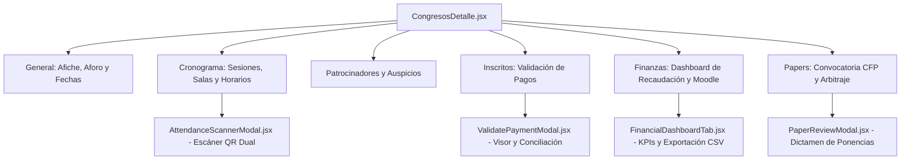
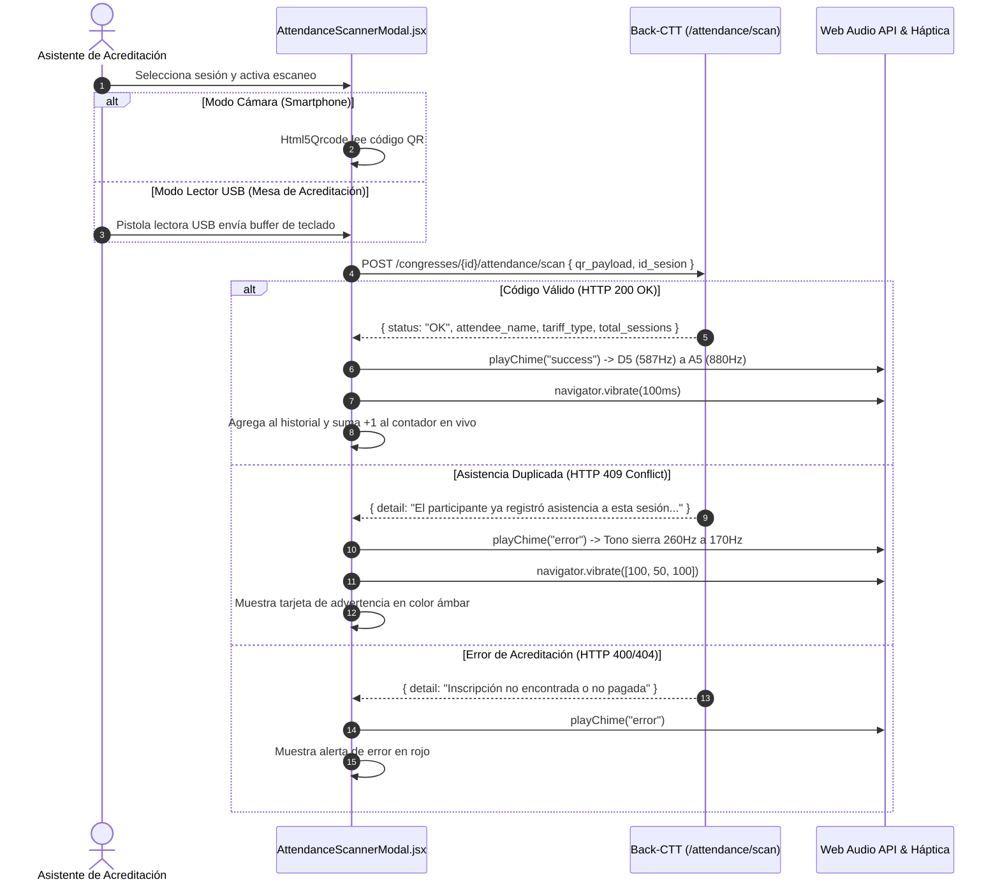

# Gestión Académica, Acreditación y Dashboard Financiero (CTT-ADMIN)

Este documento detalla la arquitectura de los módulos críticos de administración de congresos, control de asistencia presencial mediante escaneo QR dual, validación tributaria de comprobantes, métricas financieras de recaudación y exportación de nóminas académicas para Moodle LMS en **CTT-ADMIN**.

---

## 1. Módulo de Administración de Congresos y Cronogramas

La vista `CongresosDetalle.jsx` (`/dashboard/congresos/:id`) centraliza el ciclo operativo de los congresos institucionales mediante una interfaz tabulada organizada en 6 áreas de trabajo:



---

## 2. Escáner de Asistencia QR a Sesiones (`AttendanceScannerModal.jsx`)

Para certificar la asistencia presencial y emitir válidamente los certificados de aprobación avalados por el CTT-FISEI, el sistema incluye un escáner industrial con soporte para entornos móviles y estaciones fijas de acreditación:



### 2.1 Soporte Dual: Cámara Móvil y Lectores USB
1. **Modo Cámara (Smartphone / Tablet)**:
   - Utiliza la librería `Html5Qrcode` para abrir la cámara trasera (`facingMode: "environment"`).
   - Incluye selector de cámaras disponibles y botón para encender la linterna del dispositivo (*torch*) en auditorios con baja iluminación.
2. **Modo Lector de Código de Barras / QR USB**:
   - Monitorea los eventos de teclado (`keydown`) en la ventana.
   - Detecta entradas rápidas sucesivas (intervalos menores a 45 ms entre pulsaciones) típicas de pistolas lectoras USB, acumulando el buffer en `keyBufferRef` hasta recibir la tecla `Enter`.
   - Permite operar terminales de acreditación física a gran velocidad sin necesidad de apuntar el puntero del mouse sobre un campo de texto.

### 2.2 Feedback Sensorial Nativo (Cero Archivos Externos)
Para no depender de la descarga de archivos `.mp3` o `.wav` que puedan fallar por conectividad:
- **Audio Sintetizado con Web Audio API**:
  - `playChime("success")`: Genera un acorde ascendente de dos notas en onda senoidal pura (587.33 Hz seguido de 880 Hz con desvanecimiento exponencial).
  - `playChime("error")`: Genera un tono grave descendente en onda triangular (260 Hz a 170 Hz).
- **Vibración Háptica (`navigator.vibrate`)**:
  - Éxito: Pulsación corta de 100 ms.
  - Conflicto o Error: Patrón de alerta doble de 100 ms - 50 ms pausa - 100 ms.

### 2.3 Manejo de Conflicto de Duplicidad (HTTP 409 Conflict)
Si un participante intenta escanear su credencial más de una vez en la misma sesión académica, el backend rechaza el registro con código `HTTP 409 Conflict`. El modal interpreta este código para alertar al operador sin interrumpir el flujo continuo de acreditación.

---

## 3. Dashboard Financiero y Nóminas (`FinancialDashboardTab.jsx`)

El módulo financiero permite monitorizar la salud económica de cada evento y automatizar la matriculación en la plataforma virtual universitaria.

### 3.1 Métricas Clave de Recaudación (KPIs)
El endpoint `GET /api/v1/congresses/{id}/financial-summary` consolida en tiempo real:
- **Recaudación Total (`total_revenue`)**: Monto acumulado de pagos confirmados.
- **Presupuesto Objetivo (`total_budget`)**: Meta financiera calculada a partir del aforo y las tarifas del congreso.
- **Tasa de Conversión (`conversion_rate`)**: Porcentaje de inscripciones en estado `INTERESADO` que completaron el pago bancario.
- **Progreso del Presupuesto**: Barra porcentual de avance financiero institucional.

### 3.2 Desglose de Ingresos por Tipo de Arancel Educativo
El sistema desglosa los participantes y montos según la estructura arancelaria aprobada por el Consejo Directivo de la FISEI:

| Tipo de Arancel | Monto Unitario | Población Objetivo | Beneficios Incluidos |
|---|---|---|---|
| **Estudiante UTA** | **$20.00** | Alumnos regulares de pregrado de la UTA | Acceso a ponencias, salas de laboratorio y certificado de aprobación. |
| **Profesional / General** | **$50.00** | Docentes externos, investigadores y profesionales de la industria | Acceso total, memorias y certificado de 40 horas académicas. |
| **Ponente Científico** | **$80.00** | Autores de manuscritos aprobados por el comité académico en el CFP | Certificado de ponente, kit institucional y publicación indexada. |

---

## 4. Exportador Oficial Moodle LMS

Para erradicar la matriculación manual de cientos de estudiantes en las aulas virtuales de la FISEI, el componente implementa la descarga en 1 clic de la nómina en formato nativo de Moodle:

```javascript
const handleDownloadMoodleCsv = async () => {
  const res = await api.get(`/congresses/${congressId}/export/moodle-csv`, {
    responseType: "blob",
  });
  const blob = new Blob([res.data], { type: "text/csv;charset=utf-8;" });
  const url = window.URL.createObjectURL(blob);
  const link = document.createElement("a");
  link.href = url;
  link.download = `moodle_enrollments_congreso_${congressId}.csv`;
  link.click();
};
```

- **Estructura del Encabezado CSV**:
  ```csv
  username,firstname,lastname,email,course1,role1
  ```
- **Compatibilidad**: Cumple con el estándar de carga masiva de usuarios de Moodle (*Upload users*), asignando el rol `student` en el código corto del curso correspondiente al congreso.
- **Sincronización Directa API**: Incluye botón para sincronización desatendida mediante tokens de servicio web Moodle REST.

---

## 5. Validación y Conciliación de Pagos (`ValidatePaymentModal.jsx`)

Cuando un participante sube su comprobante bancario desde el portal web, la matrícula aparece en la pestaña de inscritos de `CongresosDetalle.jsx`. El modal `ValidatePaymentModal.jsx` permite al tesorero revisar y dictaminar:

1. **Visor Integrado de Comprobante**: Soporte para previsualización directa de archivos PDF e imágenes en alta resolución con opción de apertura en pestaña independiente.
2. **Auditoría de Datos Fiscales**: Visualización de Cédula/RUC, Razón Social, Dirección y Correo electrónico declarados por el estudiante para la emisión del comprobante electrónico SRI.
3. **Acciones de Conciliación**:
   - **Aprobar Pago (`PAGADO`)**: Habilita la emisión del pase digital QR al estudiante.
   - **Marcar Facturado (`FACTURADO`)**: Vincula el pago a la factura institucional emitida y libera la descarga del RIDE PDF.
   - **Rechazar Comprobante (`INTERESADO`)**: Retorna la inscripción al estado inicial y solicita al participante adjuntar un comprobante legible o corregir el depósito.
