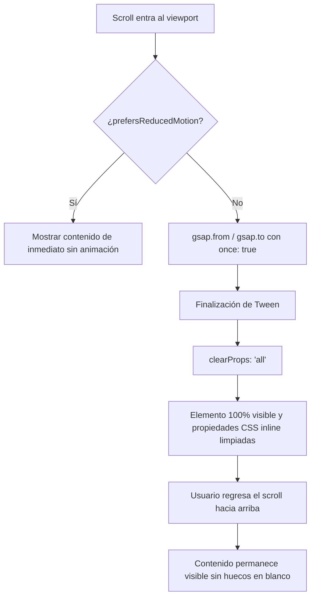

# Arquitectura de Animaciones con GSAP y ScrollTrigger (CTT-WEB)

Este documento detalla la arquitectura de animaciones de interfaz implementada en **CTT-WEB**, el uso de la biblioteca oficial GreenSock Animation Platform (GSAP 3) junto a `@gsap/react`, y el cumplimiento estricto de las directrices institucionales de rendimiento y estabilidad visual establecidas en `AGENTS.md`.

---

## 1. Configuración Centralizada (`src/utils/gsapConfig.js`)

Para asegurar consistencia en la inicialización de plugins, manejo de eventos y respeto por las preferencias de accesibilidad del usuario, la configuración de GSAP está centralizada en un único módulo exportable:

```javascript
import gsap from "gsap";
import { ScrollTrigger } from "gsap/ScrollTrigger";
import { useGSAP } from "@gsap/react";

// Registrar plugins oficiales en el motor GSAP
gsap.registerPlugin(ScrollTrigger, useGSAP);

// Configuración global de ScrollTrigger para dispositivos móviles y eventos
ScrollTrigger.config({
  limitCallbacks: true,
  ignoreMobileResize: true,
});

/**
 * Helper para verificar si el usuario prefiere movimiento reducido
 * según la directiva del sistema operativo (CSS media query)
 */
export const prefersReducedMotion = () => {
  return typeof window !== "undefined" && window.matchMedia("(prefers-reduced-motion: reduce)").matches;
};

export { gsap, ScrollTrigger, useGSAP };
export default gsap;
```

---

## 2. Reglas Institucionales Estrictas (`AGENTS.md`)

Las animaciones del ecosistema CTT deben priorizar la experiencia del usuario, evitando efectos distractores, saltos bruscos o pérdida involuntaria de contenido durante la navegación.



### 2.1 Cero Desaparición de Elementos (Prohibición de `toggleActions: "play reverse"`)
- **Regla**: Queda estrictamente prohibido animar elementos hacia `opacity: 0` al desplazarse en sentido contrario o salir del viewport.
- **Justificación**: En sitios institucionales y educativos, hacer que los textos o tarjetas se desvanezcan al regresar el scroll genera una sensación de parpadeo, desorientación y lentitud perceptible.
- **Implementación**: Todas las animaciones controladas por ScrollTrigger deben configurarse con `once: true`, disparándose una única vez al entrar al campo de visión del participante.

### 2.2 Uso Obligatorio de `clearProps: "all"`
- **Regla**: Al finalizar la animación de entrada, se deben limpiar todas las propiedades CSS inline aplicadas por el motor GSAP (`opacity`, `transform`, `will-change`).
- **Justificación**: Si las propiedades inline permanecen en el DOM, interfieren con los estilos responsivos de Tailwind CSS (como `hover:scale-105` o transiciones de tema oscuro) y pueden causar artefactos de renderizado en navegadores móviles.
- **Implementación**: Inclusión mandatoria de `clearProps: "all"` en las opciones del tween de GSAP.

### 2.3 Reseteo Inmediato de Scroll en Cambios de Ruta (`ScrollToTop.jsx`)
- **Regla**: Cada navegación a una nueva ruta debe resetear la posición del viewport a `top: 0, left: 0` de manera instantánea (`behavior: "instant"`).
- **Sincronización con ScrollTrigger**: Al montar una nueva página, se debe ejecutar `ScrollTrigger.refresh()` tras un micro-delay (aprox. 60 ms) para que el motor recalcule con precisión las alturas y coordenadas de todos los disparadores.

---

## 3. Patrones de Implementación con `useGSAP`

El hook oficial `@gsap/react` (`useGSAP`) proporciona aislamiento de selectores (mediante la propiedad `scope`), limpieza automática de animaciones en el desmontaje del componente y prevención de fugas de memoria.

### 3.1 Animación de Entrada y Contadores Numéricos (`Stats.jsx`)
En la sección de métricas de la portada (`Stats.jsx`), las tarjetas estadísticas aparecen con un efecto suave de cascada (*stagger*) y los valores numéricos incrementan progresivamente hasta el valor objetivo:

```jsx
import { useRef } from "react";
import { gsap, useGSAP, prefersReducedMotion } from "../../utils/gsapConfig";

export default function Stats() {
  const containerRef = useRef(null);
  const numberRefs = useRef([]);

  useGSAP(
    () => {
      // 1. Respetar preferencia de accesibilidad
      if (prefersReducedMotion()) return;

      // 2. Animación de revelado de tarjetas con ScrollTrigger y clearProps
      gsap.from(".stat-card", {
        opacity: 0,
        y: 35,
        duration: 0.8,
        stagger: 0.2,
        ease: "power3.out",
        clearProps: "all",
        scrollTrigger: {
          trigger: containerRef.current,
          start: "top 82%",
          once: true, // Disparo único garantizado
        },
      });

      // 3. Incremento numérico fluido en tiempo real
      stats.forEach((stat, idx) => {
        const el = numberRefs.current[idx];
        if (!el) return;

        const countObj = { val: 0 };
        gsap.to(countObj, {
          val: stat.value,
          duration: 1.8,
          ease: "power2.out",
          scrollTrigger: {
            trigger: containerRef.current,
            start: "top 82%",
            once: true,
          },
          onUpdate: () => {
            if (el) {
              const currentInt = Math.floor(countObj.val);
              el.innerText = `${currentInt.toLocaleString("es-ES")}${stat.suffix}`;
            }
          },
        });
      });
    },
    { scope: containerRef }
  );

  return (
    <div ref={containerRef} className="grid grid-cols-1 md:grid-cols-3 gap-6">
      {/* Elementos con clase .stat-card */}
    </div>
  );
}
```

### 3.2 Animación Selectiva de Catálogo y Paginación (`CoursesList.jsx`)
Cuando el estudiante navega por el catálogo de cursos o aplica filtros, las tarjetas se animan sin provocar parpadeos en los elementos ya visibles:

```jsx
useGSAP(
  () => {
    if (prefersReducedMotion() || filteredCourses.length === 0) return;

    if (page === 1) {
      // En la primera carga o filtro inicial, animar el lote completo
      gsap.from(".catalog-card-item", {
        opacity: 0,
        y: 20,
        duration: 0.4,
        stagger: 0.04,
        ease: "power2.out",
        clearProps: "all",
      });
    } else if (filteredCourses.length > prevCoursesCountRef.current) {
      // Al cargar más cursos, animar ÚNICAMENTE las tarjetas recién agregadas
      const startIndex = prevCoursesCountRef.current + 1;
      const newCards = gridContainerRef.current?.querySelectorAll(
        `.catalog-card-item:nth-child(n+${startIndex})`
      );
      if (newCards && newCards.length > 0) {
        gsap.from(newCards, {
          opacity: 0,
          y: 15,
          duration: 0.35,
          stagger: 0.03,
          ease: "power2.out",
          clearProps: "all",
        });
      }
    }

    prevCoursesCountRef.current = filteredCourses.length;
  },
  { dependencies: [filteredCourses.length, page], scope: gridContainerRef }
);
```

### 3.3 Carrusel Institucional (`Carousel.jsx`) y Banners (`Banner.jsx`)
- En las transiciones de diapositivas de la página principal, las imágenes y textos utilizan una línea de tiempo (`gsap.timeline()`) que desvanece de manera sutil el slide saliente (`opacity: 0.2` a `opacity: 1`) al tiempo que desplaza ligeramente los textos (`x: 25` a `0`), entregando dinamismo con tiempos de ejecución inferiores a 0.7 segundos.
- La propiedad `ignoreMobileResize: true` en `ScrollTrigger.config()` evita recálculos innecesarios y saltos visuales cuando el navegador móvil oculta o muestra su barra de navegación durante el desplazamiento vertical.
