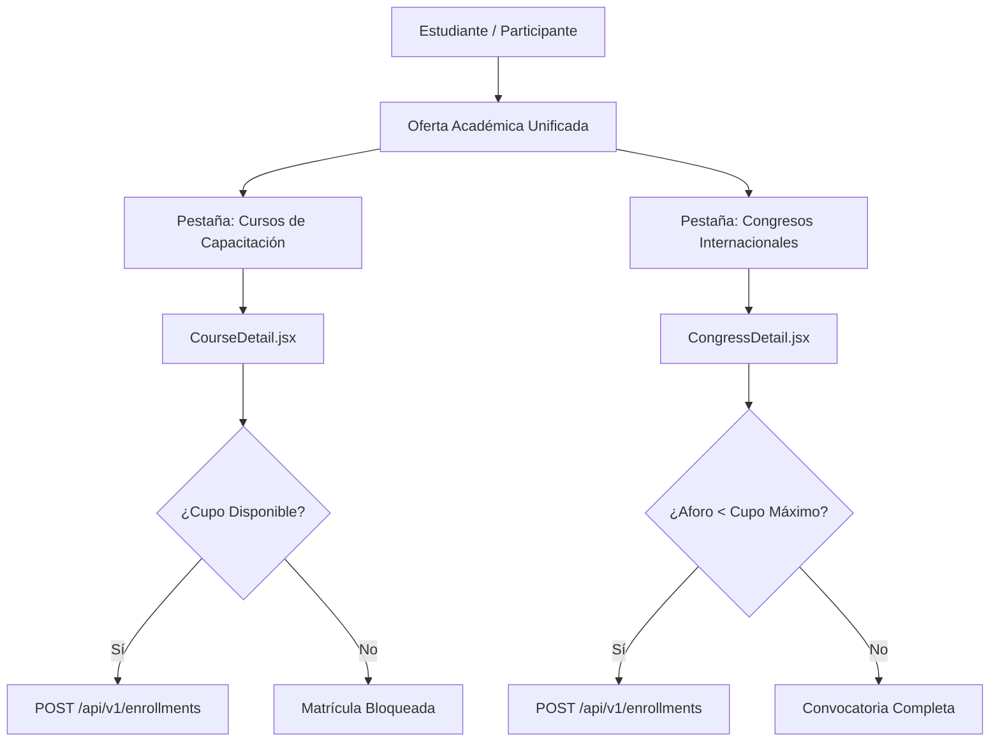
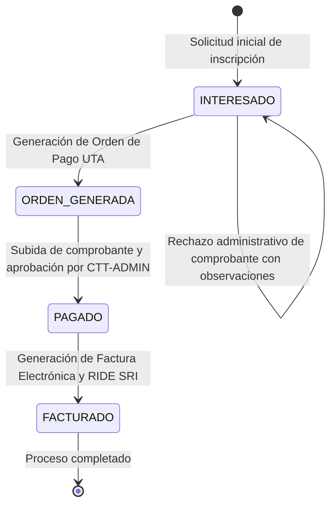

# Catálogo Unificado, Inscripciones y Gestión Financiera (CTT-WEB)

Este documento describe la arquitectura funcional y técnica de los módulos de descubrimiento académico, matriculación con aforo controlado, gestión de órdenes de pago, comprobantes para el SRI, perfil del estudiante, emisión de RIDE oficial y módulos complementarios de acreditación e investigación en **CTT-WEB**.

---

## 1. Catálogo Unificado de Oferta Académica

El portal ofrece una experiencia integral de exploración a través de las vistas `OfertaAcademica.jsx` (en el Dashboard) y los catálogos públicos `Courses.jsx` y `Events.jsx`.



### 1.1 Control Estricto de Aforo (`cupo_maximo`)
En eventos masivos y congresos internacionales (tales como el CSEI - *Conference on Computer Science and Information Technology* y el CISED - *Congreso de Innovación Social, Educación y Desarrollo*), la disponibilidad física y de salas impone un límite estricto de asistentes (`cupo_maximo`):

- **Cálculo en tiempo real**:
  ```javascript
  const cupoMaximo = Number(congress?.cupo_maximo || 250);
  const capacityPercentage = cupoMaximo > 0 ? Math.min(Math.round((inscritos / cupoMaximo) * 100), 100) : 0;
  const isQuotaExceeded = cupoMaximo > 0 && inscritos >= cupoMaximo;
  ```
- **Bloqueo preventivo de interfaz**:
  Cuando el aforo se completa al 100%, el botón de inscripción se deshabilita automáticamente y se despliega una alerta preventiva indicando: *"Convocatoria completa. No hay cupos disponibles para este congreso."*
- **Garantía en Backend**:
  Si múltiples participantes intentan inscribirse simultáneamente sobrepasando el límite disponible, el endpoint `POST /api/v1/enrollments` rechaza la solicitud con código `HTTP 400 Bad Request` y el mensaje institucional:
  ```json
  {
    "detail": "El cupo máximo (N participantes) ha sido alcanzado. Convocatoria cerrada."
  }
  ```

---

## 2. Ciclo de Vida de Inscripciones y Órdenes de Pago

El sistema modela una máquina de estados determinista para cada matrícula, asegurando la trazabilidad de los pagos bancarios y su validación administrativa:



### 2.1 Descripción de Estados
1. **`INTERESADO`**:
   El estudiante ha registrado su intención de matricularse pero aún no ha generado la orden de recaudación universitaria.
2. **`ORDEN_GENERADA`**:
   Se emite el documento formal de la orden de pago UTA en formato PDF (`/enrollments/{id}/payment-order/download`) con el código de trámite para cancelación en ventanillas bancarias autorizadas (Banco del Pacífico, Banco Pichincha o Tesorería UTA).
3. **`PAGADO`**:
   El participante adjunta la imagen o PDF de su comprobante de depósito/transferencia a través del modal `PaymentReceiptModal.jsx`. El departamento financiero en `CTT-ADMIN` revisa el comprobante y aprueba el pago.
4. **`FACTURADO`**:
   La Tesorería de la UTA concilia la recaudación y genera la factura electrónica institucional con el RUC universitario (`1860000880001`), emitiendo el RIDE oficial con tarifa 0% IVA para servicios de educación superior.

---

## 3. Modal de Carga de Comprobante y Datos SRI (`PaymentReceiptModal.jsx`)

Para cumplir con las regulaciones tributarias de la República del Ecuador (SRI), el modal de carga de comprobantes solicita de forma obligatoria y pre-carga los datos fiscales del estudiante:

- **Campos Tributarios Requeridos**:
  - Cédula de Identidad o RUC (`billing_identification`).
  - Razón Social o Nombres Completos del contribuyente (`billing_name`).
  - Dirección fiscal (`billing_address`).
  - Teléfono de contacto (`billing_phone`).
  - Correo electrónico para entrega del comprobante electrónico XML/RIDE (`billing_email`).
- **Archivo de Comprobante**:
  Soporta formatos `application/pdf`, `image/jpeg`, `image/png` y `image/webp` con un tamaño máximo permitido de **5 MB**.
- **Acción en Servidor**:
  Al presionar "Registrar Comprobante", se sincronizan primero los datos fiscales mediante `PUT /api/v1/users/{id}/billing` y a continuación se sube el archivo binario a `/api/v1/enrollments/{id}/upload-payment-receipt`.

---

## 4. Perfil Integral del Estudiante (`/dashboard/perfil`)

El perfil del estudiante centraliza toda la gestión de cuenta a través de un panel organizado en 4 pestañas:

| Pestaña | Funcionalidad | Endpoints Involucrados |
|---|---|---|
| **1. Datos Personales** | Modificación de nombres, apellidos, teléfono y dirección residencial. El número de identificación (cédula/pasaporte) permanece bloqueado para prevenir usurpación de identidad académica. | `PUT /api/v1/users/{id}/profile` |
| **2. Facturación SRI** | Configuración de los datos fiscales predeterminados para la emisión automática de facturas en futuras capacitaciones. | `PUT /api/v1/users/{id}/billing` |
| **3. Seguridad** | Cambio de clave de acceso. Requiere ingresar la contraseña actual, validada con hashing seguro `bcrypt` en el servidor, e ingresar la nueva contraseña (mínimo 6 caracteres). | `PUT /api/v1/users/{id}/password` |
| **4. Historial Financiero** | Registro detallado de todas las órdenes emitidas, con indicadores de estado, botones de descarga de órdenes de pago, visor de comprobantes y descarga directa del RIDE oficial. | `GET /api/v1/users/{id}/enrollments` |

---

## 5. Pase Digital QR y Descarga de RIDE Oficial UTA

### 5.1 Credencial de Acceso con Código QR
Una vez que la matrícula alcanza el estado `PAGADO` o `FACTURADO`, el participante obtiene su pase digital para el ingreso presencial a los auditorios y salas de conferencia:

- **Estructura del Payload QR**:
  ```
  UTA-FISEI-PASS-{enrollment_id}-{congress_id}
  ```
  *Ejemplo real*: `UTA-FISEI-PASS-12-1` identifica de manera unívoca la inscripción #12 al congreso #1.
- **Validación en Puerta**:
  El personal de acreditación escanea este código desde la aplicación administrativa `CTT-ADMIN` para registrar la asistencia en tiempo real a cada sesión del cronograma.

### 5.2 Descarga del Comprobante Oficial RIDE UTA
Desde la vista de `CursosInscritos.jsx` o el historial del `Perfil.jsx`, los estudiantes con matrículas en estado `FACTURADO` pueden descargar en 1 clic el documento PDF oficial generado dinámicamente con ReportLab:

```javascript
const handleDownloadRide = async (enrollmentId) => {
  const downloadUrl = `${apiUrl}/enrollments/${enrollmentId}/ride/download`;
  const res = await fetch(downloadUrl, {
    headers: token ? { Authorization: `Bearer ${token}` } : {},
  });
  if (!res.ok) throw new Error("No se pudo descargar el comprobante RIDE oficial.");
  const blob = await res.blob();
  const url = window.URL.createObjectURL(blob);
  const a = document.createElement("a");
  a.href = url;
  a.download = `RIDE_UTA_${String(enrollmentId).padStart(9, "0")}.pdf`;
  a.click();
};
```

---

## 6. Módulos Complementarios

### 6.1 Convocatoria de Artículos Científicos (Call for Papers - CFP)
Dentro de la ficha de detalle de los congresos (`CongressDetail.jsx`), los investigadores pueden postular ponencias científicas completando el formulario de envío:
- **Campos del Paper**:
  - Título del manuscrito (`paperTitle`).
  - Track o línea temática (`paperTrack`): Inteligencia Artificial, Sistemas Embebidos, Ciberseguridad, Redes de Comunicación o Robótica Industrial.
  - Palabras clave (`paperKeywords`).
  - Resumen o Abstract académico (`paperAbstract`).
  - Enlace al documento PDF completo alojado en repositorio institucional o servidor seguro (`paperFileUrl`).
- **Beneficio Arancelario**:
  Al ser dictaminado favorablemente por los revisores académicos en `CTT-ADMIN`, el autor principal queda exonerado de la tarifa ordinaria de profesional ($50) y se le asigna de manera preferencial y automática la tarifa de **Ponente ($80)**, que incluye kit académico, acceso a plenarias y publicación en memorias indexadas.

### 6.2 Encuesta de Calidad Académica CACES (`SurveyModal.jsx`)
Para respaldar los procesos de autoevaluación y acreditación institucional exigidos por el Consejo de Aseguramiento de la Calidad de la Educación Superior (CACES), la plataforma despliega una encuesta obligatoria a los asistentes de cada congreso:
- **Dimensiones Evaluadas** (Escala Likert de 1 a 5 estrellas):
  1. *Calidad del contenido y actualidad de las ponencias*.
  2. *Organización logística, puntualidad y cumplimiento del cronograma*.
  3. *Relevancia del evento para el perfil profesional*.
- **Comentarios Cualitativos**: Campo de texto abierto para sugerencias de mejora.
- **Persistencia**: Registro en la base de datos vinculado al congreso y a la cuenta del estudiante, impidiendo evaluaciones duplicadas.
