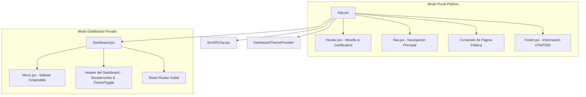

# Componentes y Sistema de Rutas (CTT-WEB)

Este documento detalla la estructura del árbol de componentes, la configuración de enrutamiento con React Router DOM v7, el mecanismo de guardias de navegación y el ciclo de vida de autenticación del portal del estudiante **CTT-WEB**.

---

## 1. Layout Institucional

La interfaz de usuario implementa un esquema visual estructurado que separa limpiamente la experiencia de navegación del portal público de la del panel del estudiante (Dashboard).



### 1.1 Barra Superior (`Header.jsx`) y Barra de Navegación (`Nav.jsx`)
En el portal público, `Header.jsx` expone accesos directos institucionales a la plataforma Moodle de la FISEI (`https://ctt-talleresfisei.uta.edu.ec/edu/login/index.php`) y al validador público de certificados (`verify_certificate.php`).

Por su parte, `Nav.jsx` ofrece navegación responsiva entre las páginas principales:
- Inicio (`/`)
- Cursos (`/courses`)
- Eventos y Congresos (`/events`)
- Nosotros (`/nosotros`)
- Contacto (`/contact`)
- Acceso al Campus Virtual / Inicio de Sesión (`/login`)

### 1.2 Menú Lateral del Dashboard (`Menu.jsx`)
Ubicado dentro de `/dashboard`, `Menu.jsx` provee acceso contextual a las áreas del estudiante:
- **Oferta Académica**: Acceso unificado a cursos y congresos disponibles.
- **Mis Cursos**: Listado de inscripciones activas con seguimiento de estado.
- **Órdenes de Pago**: Gestión de pagos pendientes y comprobantes validados.
- **Mi Perfil**: Módulo con 4 pestañas para actualización de información personal, configuración fiscal del SRI, cambio de contraseña y trazabilidad financiera.

El sidebar soporta colapso horizontal interactivo (`isCollapsed`), persistiendo la preferencia en `localStorage.getItem('sidebar_collapsed')`. En dispositivos móviles se comporta como un menú deslizable que bloquea el scroll de fondo.

### 1.3 Reseteo de Posición de Scroll (`ScrollToTop.jsx`)
Para garantizar que al transicionar entre rutas el usuario empiece siempre desde el encabezado superior sin arrastrar la posición de scroll de la página previa, `ScrollToTop.jsx` se monta en la raíz de `App.jsx`:

```jsx
export default function ScrollToTop() {
  const { pathname } = useLocation();

  useEffect(() => {
    window.scrollTo({
      top: 0,
      left: 0,
      behavior: "instant",
    });
    if (document.documentElement) document.documentElement.scrollTop = 0;
    if (document.body) document.body.scrollTop = 0;

    // Refrescar ScrollTrigger tras el montaje del nuevo componente
    const timer = setTimeout(() => {
      ScrollTrigger.refresh();
    }, 60);

    return () => clearTimeout(timer);
  }, [pathname]);

  return null;
}
```

---

## 2. Árbol de Rutas

El enrutamiento está centralizado en `src/App.jsx` utilizando la sintaxis de rutas declarativas de React Router DOM:

| Ruta | Componente | Acceso | Descripción |
|---|---|---|---|
| `/` | `Home.jsx` | Público | Portada institucional con carrusel, estadísticas y destacados. |
| `/courses` | `Courses.jsx` | Público | Catálogo interactivo de cursos con filtros por categoría. |
| `/course/:id` | `CourseDetail.jsx` | Público | Detalle informativo del curso (objetivos, temario, requisitos). |
| `/curso/:id` | `CourseDetail.jsx` | Público | Alias semántico en español para detalle del curso. |
| `/events` | `Events.jsx` | Público | Catálogo de congresos científicos internacionales y talleres. |
| `/congreso/:id` | `CongressDetail.jsx` | Público | Ficha completa del congreso, cupo en vivo, ponencias y CFP. |
| `/congress/:id` | `CongressDetail.jsx` | Público | Alias en inglés para el detalle de congreso. |
| `/nosotros` | `Nosotros.jsx` | Público | Misión, visión, organigrama y autoridades del CTT-FISEI. |
| `/contact` | `Contact.jsx` | Público | Canales de atención presencial, correo y formularios de consulta. |
| `/login` | `Login.jsx` | Público | Selector de autenticación (Credenciales locales o Microsoft 365). |
| `/register` | `Register.jsx` | Público | Formulario de registro de nuevas cuentas de participantes. |
| `/dashboard` | `Dashboard.jsx` | **Privado** | Contenedor principal del panel del estudiante con barra lateral. |
| `/dashboard/oferta` | `OfertaAcademica.jsx` | **Privado** | Vista tabulada de programas y congresos abiertos a matrícula. |
| `/dashboard/cursos/inscrito` | `CursosInscritos.jsx` | **Privado** | Mis matrículas, estado de comprobante, descarga de RIDE y QR. |
| `/dashboard/ordenes/pendientes` | `Ordenes.jsx` (`pendientes`) | **Privado** | Órdenes que requieren pago en ventanilla bancaria o subida de voucher. |
| `/dashboard/ordenes/completadas` | `Ordenes.jsx` (`completadas`) | **Privado** | Órdenes aprobadas y facturadas con acceso a facturas electrónicas. |
| `/dashboard/perfil` | `Perfil.jsx` | **Privado** | Gestión integral de perfil, datos fiscales SRI y seguridad bcrypt. |

---

## 3. Flujo de Autenticación y Guardias de Navegación

El control de acceso a las rutas protegidas se gestiona mediante el componente `PrivateRoute` integrado en `App.jsx`, el cual valida en cada render la vigencia de las credenciales del usuario:

```jsx
const PrivateRoute = ({ children }) => {
  return isAuthenticated() ? children : <Navigate to="/login" replace />;
};
```

### 3.1 Almacenamiento Seguro de Sesión (`src/utils/auth.js`)
La sesión se almacena en el `localStorage` del navegador bajo tres claves esenciales:
1. `token`: Token JWT emitido por el backend de FastAPI.
2. `user`: Objeto JSON con los datos del participante autenticado.
3. `loginTime`: Marca de tiempo en milisegundos correspondiente al momento del inicio de sesión.

```javascript
export const saveAuthData = (token, user) => {
  localStorage.setItem('token', token);
  localStorage.setItem('user', JSON.stringify(user));
  localStorage.setItem('loginTime', new Date().getTime().toString());
  // Emisión de evento personalizado para sincronización reactiva inmediata
  window.dispatchEvent(new Event('authChange'));
};
```

### 3.2 Política de Expiración de Sesión (8 Horas)
Para cumplir con las normas de seguridad institucional, la sesión posee una duración máxima de 8 horas continuas (28.800.000 ms). Si el tiempo transcurrido supera dicho límite, los datos de autenticación se purgan automáticamente y el usuario es redirigido a la pantalla de login:

```javascript
export const isAuthenticated = () => {
  const token = localStorage.getItem('token');
  const loginTime = localStorage.getItem('loginTime');
  
  if (!token || !loginTime) {
    return false;
  }
  
  const eightHours = 8 * 60 * 60 * 1000;
  const currentTime = new Date().getTime();
  const timePassed = currentTime - parseInt(loginTime, 10);
  
  if (timePassed >= eightHours) {
    clearAuthData();
    return false;
  }
  
  return true;
};
```

El hook `useSessionExpiration` se monta en la raíz de la aplicación para programar un temporizador de fondo (`setTimeout`) que ejecuta el deslogueo en tiempo real al vencer la ventana de 8 horas, notificando al usuario sin necesidad de recargar la página.

### 3.3 Evento de Sincronización `authChange`
Toda modificación de credenciales (`saveAuthData` o `clearAuthData`) dispara el evento nativo del DOM `authChange`. Los componentes como `Nav.jsx` y `Menu.jsx` escuchan este evento para actualizar su estado de renderizado al instante, alternando entre los botones de "Iniciar Sesión" y el menú con el avatar del usuario.

---

## 4. Gestión de Tema Visual (`DashboardThemeContext.jsx`)

Para proporcionar una experiencia visual cómoda y adaptada a condiciones de baja iluminación, la aplicación cuenta con un contexto de tema (`DashboardThemeContext`):
- Soporta modos `light` y `dark`.
- Alterna la clase CSS `.dark` en el elemento raíz `<html>`.
- Persiste la elección del usuario en `localStorage.getItem('dashboard_theme')`.
- En modo oscuro, las superficies utilizan tonos grafito de alta legibilidad (`#121215`, `#16161a`) con textos en blanco puro o zinc claro (`#f4f4f5`), garantizando un contraste óptimo y eliminando el deslumbramiento.
