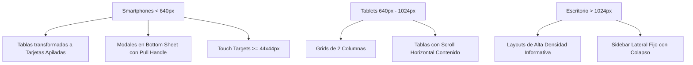

# Diseño Responsive, Sistema Visual y Accesibilidad (CTT-WEB)

Este documento describe la estrategia de diseño responsivo *Mobile-First*, el sistema cromático y tipográfico institucional de la Universidad Técnica de Ambato (UTA), y los estándares de accesibilidad aplicados en el portal público y dashboard del estudiante **CTT-WEB**.

---

## 1. Estrategia Mobile-First y Breakpoints

El diseño de interfaces sigue una arquitectura adaptativa progresiva soportada por las directivas nativas de Tailwind CSS v4:



### 1.1 Dispositivos Móviles (`< 640px` - Breakpoint por defecto)
Para asegurar que los estudiantes puedan consultar su avance académico o descargar recibos desde sus smartphones sin fricciones de desplazamiento:
- **Transformación de Tablas a Tarjetas Apiladas**:
  Las tablas de inscripciones y órdenes de pago (`CursosInscritos.jsx`, `Ordenes.jsx`) ocultan la estructura tabular tradicional (`hidden sm:block`) y presentan en su lugar tarjetas individuales estructuradas con bordes sutiles y listas divididas (`divide-y`). Esto elimina el scroll horizontal desbordado que arruina la usabilidad en pantallas pequeñas.
- **Modales en formato Bottom Sheet**:
  En resoluciones móviles, los diálogos modales (`PaymentReceiptModal.jsx`, `SurveyModal.jsx`, `EnrollmentModal.jsx`) se anclan en la parte inferior de la pantalla (`fixed inset-0 flex items-end sm:items-center`), luciendo esquinas redondeadas superiores (`rounded-t-2xl sm:rounded-2xl`) y una barra táctil de arrastre central (`w-12 h-1.5 bg-zinc-300 dark:bg-zinc-700 rounded-full mx-auto mt-2.5 mb-1 sm:hidden`).
- **Áreas Táctiles Mínimas (Touch Targets >= 44x44px)**:
  Todos los botones de acción, selectores, controles de paginación e iconos interactivos implementan dimensiones mínimas de 44x44 píxeles (`min-h-[44px]`), cumpliendo rigurosamente con los criterios de éxito WCAG 2.1 (Nivel AA / AAA) y las pautas ergonómicas de Apple HIG y Google Material Design.

### 1.2 Tablets (`640px - 1024px` - Breakpoint `sm` y `md`)
- Reorganización de cuadrículas de cursos y congresos a 2 columnas balanceadas (`grid grid-cols-1 sm:grid-cols-2`).
- Tablas contenidas con desplazamiento horizontal suave y cabeceras fijas (`overflow-x-auto`).
- Menú de navegación condensado con drawer lateral deslizable.

### 1.3 Pantallas de Escritorio (`> 1024px` - Breakpoint `lg` y `xl`)
- Cuadrículas expansivas de 3 y 4 columnas para el catálogo general.
- Barra lateral de navegación fija con opción de colapso rápido para maximizar el área de trabajo.
- Visualización simultánea de paneles de temarios, requisitos y ficha de inversión en la vista de detalle de cursos y congresos.

---

## 2. Paleta Cromática Institucional

La identidad visual del proyecto está anclada en el color institucional oficial de la Universidad Técnica de Ambato y la Facultad FISEI:

| Variable CSS / Token | Hexadecimal | Uso y Aplicación |
|---|---|---|
| `--color-primary` | `#00345e` | **Azul Institucional UTA**: Encabezados primarios, botones principales, acentos activos y barras de navegación. |
| `--color-primary-hover` | `#002747` | Estado hover de botones primarios e interactivos. |
| `--color-primary-dark` | `#001f38` | Estado presionado (active) y fondos profundos. |
| `--color-secondary` | `#e67e22` / `#CB972D` | Tono dorado/ámbar complementario para insignias de estado y notas de arancel. |
| `--bg-dark-base` | `#121215` | Fondo principal de página en modo oscuro. |
| `--bg-dark-surface` | `#16161a` | Superficie de tarjetas y modales en modo oscuro. |
| `--border-dark` | `rgba(255, 255, 255, 0.08)` | Bordes sutiles en modo oscuro para delimitación limpia sin fatiga visual. |

### Contraste en Modo Claro y Oscuro
La alternancia de modos cromáticos garantiza un ratio de contraste superior a 4.5:1 para texto normal y 7:1 para títulos:
- **Modo Claro**: Textos principales en zinc de alta densidad (`text-zinc-900`) sobre fondos blancos puros (`bg-white`) o papel cálido (`#f6f5f4`), complementados con bordes de baja opacidad (`border-black/[0.08]`).
- **Modo Oscuro**: Textos en blanco puro o zinc brillante (`text-zinc-100`) sobre superficies oscuras profundas (`#16161a`), prohibiendo expresamente combinaciones ilegibles de texto gris oscuro sobre fondo negro o texto blanco sobre fondos claros.

---

## 3. Jerarquía Tipográfica y Reglas Institucionales (`AGENTS.md`)

### 3.1 Prohibición Estricta de Cápsulas y Eyebrow Badges Decorativos
De acuerdo con las directrices mandatorias de diseño institucional:
- **Prohibido**: Colocar pastillas o cápsulas decorativas (`rounded-full`, fondos translúcidos, iconos de chispas como `SparklesIcon`) encima de los títulos de sección (`<h2>`, `<h3>`), tales como:
  - ❌ `CAPACITACIÓN PROFESIONAL`
  - ❌ `SOBRE NOSOTROS`
  - ❌ `ESTAMOS PARA AYUDARTE`
- **Obligatorio**: Los encabezados deben ser directos, limpios y asertivos. La jerarquía visual nace del tamaño de la fuente, el peso tipográfico (`font-bold`, `font-semibold`), el espaciado vertical y el contraste de color, sin adornos superficiales propios de plantillas genéricas:

```jsx
{/* Ejemplo Correcto: Encabezado directo y limpio */}
<div className="space-y-1 pb-4 border-b border-black/[0.06] dark:border-white/[0.08]">
  <h2 className="text-xl sm:text-2xl font-bold text-zinc-900 dark:text-white tracking-tight">
    Catálogo de Cursos de Capacitación
  </h2>
  <p className="text-xs text-zinc-500 dark:text-zinc-400">
    Programas de formación continua certificados por el Centro de Transferencia y Desarrollo de Tecnologías.
  </p>
</div>
```

### 3.2 Tipografía
El sistema emplea la familia tipográfica **Roboto** en gradaciones de peso 400 (regular), 500 (medium) y 700 (bold), asegurando máxima legibilidad tanto en pantallas retina como en dispositivos de resolución estándar.
